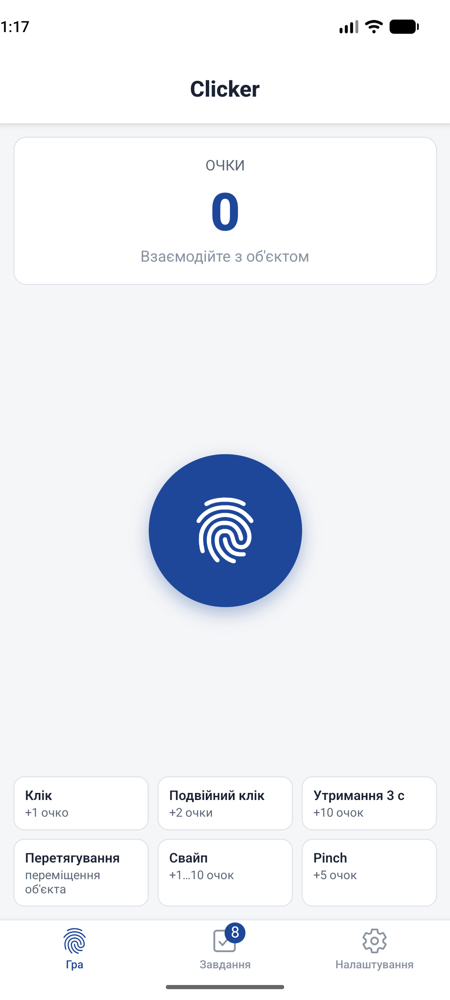
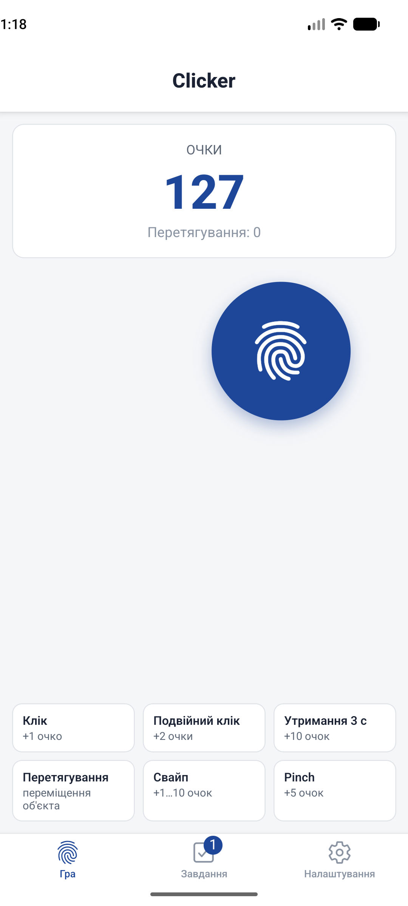
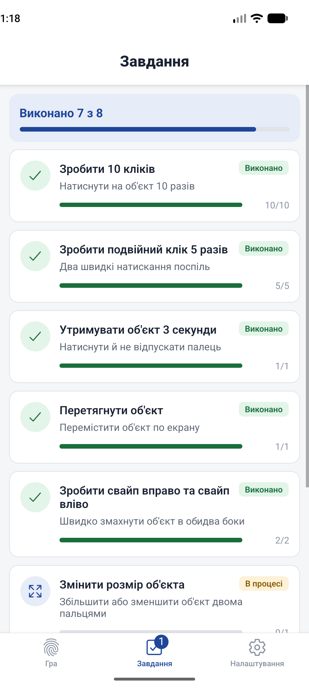
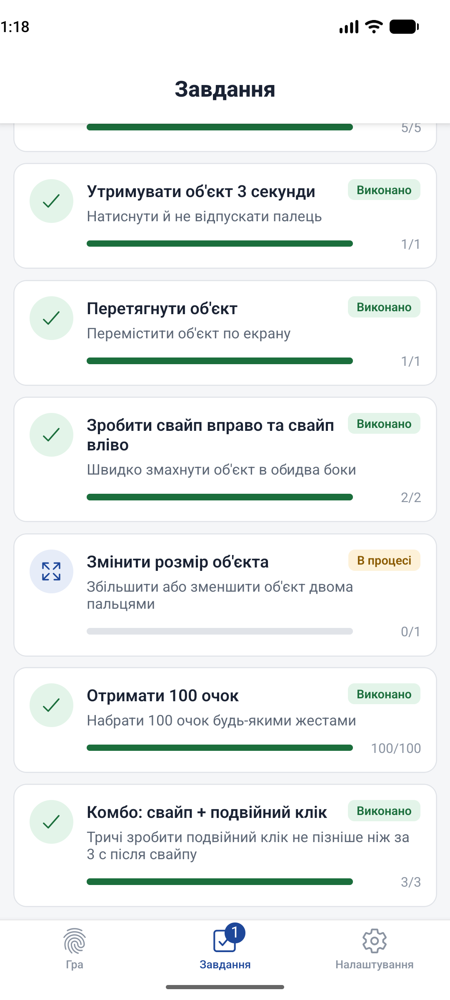
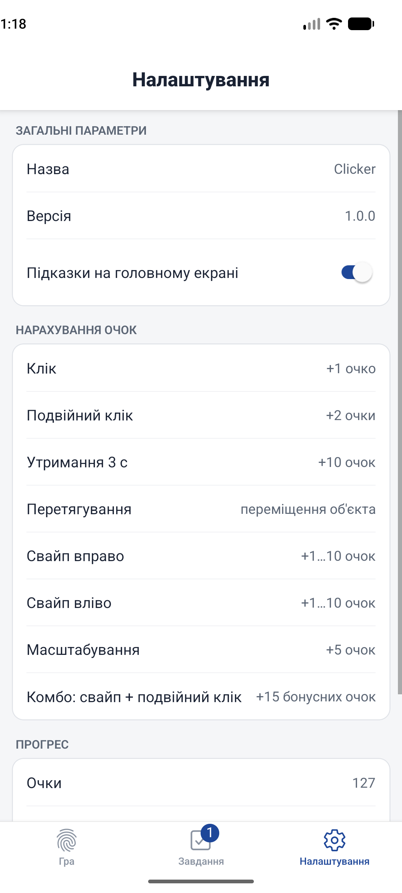
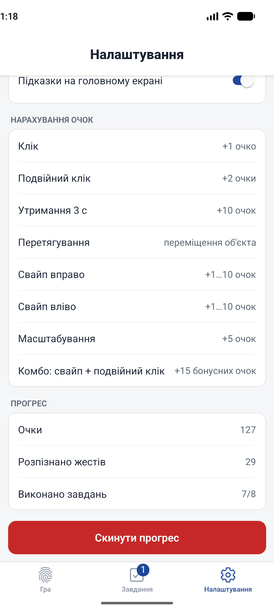
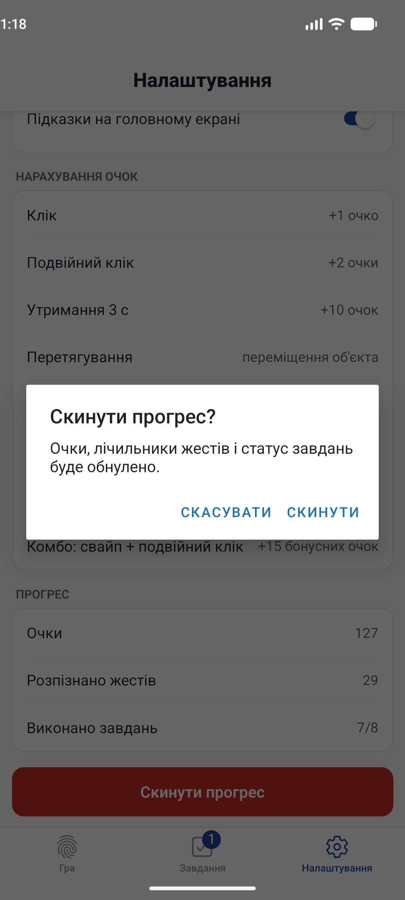

# Лабораторна робота №4 — Опрацювання жестів користувача та реалізація інтерактивної взаємодії у React Native

## Опис проєкту

Мобільний застосунок «Clicker» побудований на базі Expo та React Native і призначений для вивчення та практичного опрацювання жестів користувача за допомогою бібліотеки `react-native-gesture-handler` і `react-native-reanimated`. Додаток містить три основні екрани: головний екран «Clicker» з інтерактивним об'єктом і лічильником очок, сторінку «Завдання» з переліком завдань і відстеженням прогресу їх виконання, а також сторінку «Налаштування» з інформацією про додаток, правилами нарахування очок та можливістю скидання прогресу.

Інтерактивний об'єкт на головному екрані реагує на різноманітні типи жестів: одиночне натискання (`TapGestureHandler`, 1 очко), подвійний клік (`TapGestureHandler`, 2 очки), утримання (`LongPressGestureHandler`, 3 секунди, 10 очок), перетягування (`PanGestureHandler`), швидкий свайп (`FlingGestureHandler` вліво та вправо, випадкова кількість очок від 1 до 10), масштабування (`PinchGestureHandler`, 5 очок), а також спеціальний комбо-жест (подвійний клік протягом 3 с після свайпу, додає 15 бонусних очок). На сторінці завдань реалізовано відстеження виконання 8 завдань (включно з кліками, подвійними кліками, утриманням, перетягуванням, свайпами вліво/вправо, масштабуванням, досягненням 100 очок та комбо-завданням). Усі дані стану та прогресу зберігаються в пам'яті за допомогою React Context (`GameProvider`) і можуть бути скинуті через налаштування.

Стек: Expo SDK ~58.0.23, react-native-gesture-handler ~3.3.0, react-native-reanimated 4.7.1, expo-router ~58.0.30.

## Структура маршрутів

```text
src/
├── app/
│   ├── _layout.jsx      # Кореневий компонент з GestureHandlerRootView, GameProvider та вкладками Expo Router
│   ├── index.jsx        # Головний екран грального клікера зі скіром очок та інтерактивним об'єктом
│   ├── tasks.jsx        # Екран переліку завдань та загального прогресу їх виконання
│   └── settings.jsx     # Екран налаштувань, системної інформації та скидання прогресу
├── components/
│   ├── clicker-object.jsx # Компонент інтерактивного об'єкта з усіма обробниками жестів та Reanimated
│   ├── progress-bar.jsx   # Компонент шкали прогресу виконання завдань
│   └── task-row.jsx       # Компонент окремого рядка завдання зі статусом виконання
├── constants/
│   └── theme.js         # Колірна палиця та стильові константи застосунку
├── context/
│   └── game-store.jsx   # React Context для управління ігровим станом, очками та лічильниками
└── data/
    ├── gestures.js      # Конфігурація правил, очок та параметрів жестів
    └── tasks.js         # Визначення та логіка перевірки виконання завдань
```

## Інструкція із запуску

Для запуску проєкту виконайте такі команди в терміналі:

```bash
npm install
npx expo start
```

| Дія | Результат |
| :--- | :--- |
| Сканування QR-коду | Запуск застосунку на реальному пристрої через Expo Go |
| Натискання `a` | Відкриття застосунку в Android-емуляторі |
| Натискання `i` | Відкриття застосунку в iOS-симуляторі |
| `npx expo start --clear` | Запуск сервера розробки з попереднім очищенням кешу |
| `npx expo start --tunnel` | Запуск через тунельоване з'єднання для різних мереж |

## Скріншоти









## Висновки

Реалізовано мобільний додаток «Clicker» із підтримкою широкого спектра жестів користувача за допомогою бібліотеки `react-native-gesture-handler` та анімацій на базі `react-native-reanimated`. Ключовими техніками є використання складених обробників жестів (`Simultaneous`, `Exclusive`), робота з Shared Values та хуками Reanimated, а також управління станом через React Context. Працездатність застосунку перевірена на екранах навігації Expo Router, в ході тестування жестових взаємодій та виконання ігрових завдань в Android-емуляторі.

**1. Які основні типи жестів надає бібліотека react-native-gesture-handler та для яких сценаріїв взаємодії вони призначені?**

Бібліотека `react-native-gesture-handler` надає низку основних обробників жестів, які призначені для різноманітних сценаріїв взаємодії. `TapGestureHandler` використовується для одиночних або подвійних натискань (наприклад, для зарахування кліків по об'єкту). `LongPressGestureHandler` застосовується для тривалого утримання елемента протягом заданого часу для активації спеціальних дій чи бонусів. `PanGestureHandler` створений для вільного перетягування об'єктів по екрану у будь-якому напрямку. `FlingGestureHandler` обробляє швидкі різкі свайпи у потрібному напрямку для миттєвого реагування. `PinchGestureHandler` слугує для двопальцевого масштабування (збільшення або зменшення розміру об'єкта). `RotationGestureHandler` використовується для обертання елементів навколо їх осі.

**2. У чому відмінність між обробкою переміщення об'єкта за допомогою PanGestureHandler та швидкого зсуву через FlingGestureHandler?**

Головна відмінність між `PanGestureHandler` та `FlingGestureHandler` полягає у характерах жестів та життєвому циклі їх спрацьовування. `PanGestureHandler` призначений для неперервного відстеження переміщення пальця по екрану (зміни координат `translationX` та `translationY` у реальному часі), що ідеально підходить для перетягування об'єкта з плавним слідуванням за пальцем. Натомість `FlingGestureHandler` реагує на швидкий, різкий рух (швидкий зсув або свайп) у певному напрямку, який спрацьовує як єдина подія на завершення імпульсу, без постійного відстеження проміжного положення пальця. У нашому додатку `PanGestureHandler` використовується для перетягування фігури, а `FlingGestureHandler` — для швидких свайпів вліво та вправо з генерацією випадкових очок.

**3. Навіщо у корені застосунку необхідно обгортати компоненти в GestureHandlerRootView?**

Компонент `GestureHandlerRootView` є обов'язковою кореневою обгорткою для бібліотеки `react-native-gesture-handler`, оскільки він створює нативну кореневу структуру представлення (Root View) та налаштовує менеджер обробки жестів на нативному боці для кожної платформи (Android та iOS). Без цього обгортання нативні компоненти обробки жестів не зможуть правильно перехоплювати та обробляти дотики й жести через те, що нативна система управління подіями дотиків не буде ініціалізована. В Expo-додатках `GestureHandlerRootView` зазвичай розміщують у файлі `_layout.jsx` на найвищому рівні ієрархії, покриваючи весь екран застосунку.

**4. Яким чином можна реалізувати одночасне або послідовне спрацьовування кількох жестів на одному елементі?**

Для реалізації одночасного або послідовного спрацьовування кількох жестів на одному елементі бібліотека `react-native-gesture-handler` надає спеціальні методи композиції жестів: `.simultaneousWithExternalGesture()`, `.exclusive()`, `.requireExternalGestureToFail()`, або використання класів `Gesture.Simultaneous()`, `Gesture.Race()`, `Gesture.Sequence()`. Метод `Sequence` дозволяє виконувати жести послідовно один за одним (наприклад, спочатку натискання, а потім перетягування). Метод `Simultaneous` дозволяє обробляти кілька жестів паралельно без взаємного блокування (наприклад, одночасне перетягування та масштабування об'єкта двома пальцями). Це дозволяє гнучко керувати пріоритетами та конфліктами нативних обробників дотиків.
