# ДЕРЖАВНИЙ УНІВЕРСИТЕТ «ЖИТОМИРСЬКА ПОЛІТЕХНІКА»
Факультет інформаційно-комп'ютерних технологій
Кафедра інженерії програмного забезпечення
Спеціальність: F2 (121) «Інженерія програмного забезпечення»
Дисципліна: «Програмування для ОС Linux»
Лабораторна робота № 5
Тема: «Автоматизація збірки (Make/CMake), низькорівневе налагодження (GDB) та динамічний аналіз пам'яті (Valgrind, ASan, strace)»
Студент: Лагода Дмитро Олександрович
Група: ІПЗ-23-5
Варіант: 9
Викладач: Єфремов Юрій Миколайович

## 1. Мета роботи
Опанувати професійні інструменти збірки, діагностики та налагодження програмного забезпечення мовами C/C++ у середовищі ОС Linux. Навчитися створювати правила для систем автоматизації збірки GNU Make та CMake для мультимодульних проєктів. Опанувати покрокове налагодження виконуваних файлів та аналіз аварійних дампів пам'яті (Core Dumps) у GDB. Навчитися виявляти витоки пам'яті (Memory Leaks), некоректні звернення до покажчиків (Use-after-free, Buffer Overflow) за допомогою Valgrind Memcheck та AddressSanitizer, а також проводити системне трасування процесів через `strace`.

## 2. Індивідуальне завдання (Варіант № 9)
Варіант № 9: «Буфер циклічного логування (Ring Buffer)». Завдання:
**2.1.** Memory Corruption при перезаписі голови буфера. Моніторинг зміщення вказівника через `watch ring->head`, перевірка умов.
**2.2.** Створення інсталяційного пакету через CMake CPack (`make package` -> переповнення `.deb`).

## 3. Короткі теоретичні відомості
Мультимодульний C-проєкт розбивається на заголовні файли (`include/*.h`), модулі реалізації (`src/*.c`) та точку входу (`src/main.c`), що дозволяє інкапсулювати логіку та спрощувати командну збірку. Для автоматизації використовуються утиліта GNU Make з підтримкою псевдоцілей та параметричних правил, а також крос-платформна система CMake, яка генерує файли збірки для make у зовнішньому каталозі `build/`.
Для діагностики низькорівневих помилок пам'яті та аварій застосовуються налагоджувач GDB з підтримкою апаратних точок спостереження (`watchpoint`), інструмент динамічного аналізу Valgrind Memcheck, компіляторний санітайзер AddressSanitizer (`-fsanitize=address`) та утиліта системних викликів `strace`.

## 4. Хід виконання роботи
Крок 1. Структура проєкту:
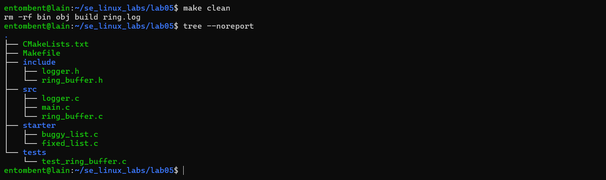
Крок 2. Аналіз стартових заготовок коду:
Файл starter/buggy_list.c:
```c
#include <stdio.h>
#include <stdlib.h>

struct Node {
    int data;
    struct Node* next;
};

int main() {
    struct Node* head = malloc(sizeof(struct Node));
    head->data = 10;
    head->next = NULL;

    free(head);
    printf("Data in head: %d\n", head->data);

    struct Node* second = malloc(sizeof(struct Node));
    second->data = 20;
    second = NULL;

    return 0;
}
```
Файл starter/fixed_list.c:
```c
#include <stdio.h>
#include <stdlib.h>

struct Node {
    int data;
    struct Node* next;
};

int main() {
    struct Node* head = malloc(sizeof(struct Node));
    head->data = 10;
    head->next = NULL;

    printf("Data in head: %d\n", head->data);
    free(head);

    struct Node* second = malloc(sizeof(struct Node));
    second->data = 20;
    free(second);
    second = NULL;

    return 0;
}
```
Аналіз стартового каркаса вказує на навмисні помилки Use-After-Free та витік пам'яті (Memory Leak) при втраті вказівника `second`, які виправляються у `fixed_list.c`.
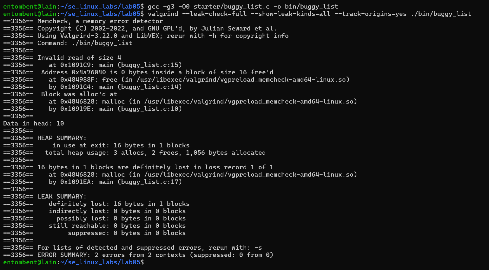
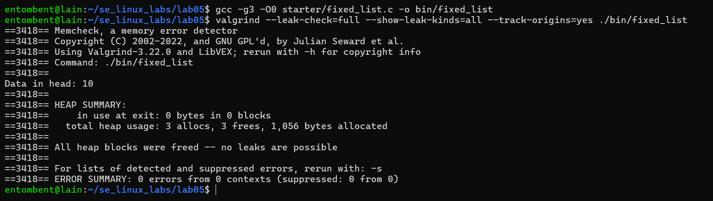
Крок 3. Вихідний код мультимодульного проєкту:
Файл include/logger.h:
```c
#ifndef LOGGER_H
#define LOGGER_H

#include "ring_buffer.h"

typedef struct Logger Logger;

Logger *logger_open(const char *path);
int logger_write(Logger *logger, const LogEntry *entry);
void logger_close(Logger *logger);

#endif
```
Файл src/logger.c:
```c
#define _POSIX_C_SOURCE 200809L

#include "logger.h"

#include <stdio.h>
#include <stdlib.h>
#include <time.h>

struct Logger {
    FILE *fp;
};

Logger *logger_open(const char *path)
{
    Logger *logger = malloc(sizeof(Logger));
    if (!logger)
        return NULL;

    logger->fp = fopen(path, "w");
    if (!logger->fp) {
        free(logger);
        return NULL;
    }
    return logger;
}

int logger_write(Logger *logger, const LogEntry *entry)
{
    struct tm tm_buf;
    char stamp[32];

    if (!localtime_r(&entry->timestamp, &tm_buf))
        return -1;
    strftime(stamp, sizeof(stamp), "%Y-%m-%d %H:%M:%S", &tm_buf);

    if (fprintf(logger->fp, "%s [#%04u] %s\n", stamp, entry->seq, entry->msg) < 0)
        return -1;
    return fflush(logger->fp);
}

void logger_close(Logger *logger)
{
    if (!logger)
        return;
    fclose(logger->fp);
    free(logger);
}
```
Крок 4. Реалізація циркулярного буфера:
Файл include/ring_buffer.h:
```c
#ifndef RING_BUFFER_H
#define RING_BUFFER_H

#include <stddef.h>
#include <stdint.h>
#include <time.h>

#define RING_MSG_LEN 48

typedef struct {
    uint32_t seq;
    time_t timestamp;
    char msg[RING_MSG_LEN];
} LogEntry;

typedef struct {
    LogEntry *head;
    LogEntry *tail;
    LogEntry *buf;
    LogEntry *end;
    size_t capacity;
    size_t count;
    uint32_t next_seq;
} RingBuffer;

RingBuffer *ring_create(size_t capacity);
void ring_push(RingBuffer *ring, const char *msg);
int ring_pop(RingBuffer *ring, LogEntry *out);
size_t ring_size(const RingBuffer *ring);
void ring_destroy(RingBuffer *ring);

#endif
```
Файл src/ring_buffer.c:
```c
#include "ring_buffer.h"

#include <stdio.h>
#include <stdlib.h>

RingBuffer *ring_create(size_t capacity)
{
    if (capacity == 0)
        return NULL;

    LogEntry *buf = calloc(capacity, sizeof(LogEntry));
    if (!buf)
        return NULL;

    RingBuffer *ring = malloc(sizeof(RingBuffer));
    if (!ring) {
        free(buf);
        return NULL;
    }

    ring->buf = buf;
    ring->head = buf;
    ring->tail = buf;
    ring->end = buf + capacity;
    ring->capacity = capacity;
    ring->count = 0;
    ring->next_seq = 1;
    return ring;
}

static LogEntry *ring_next(const RingBuffer *ring, LogEntry *slot)
{
    slot++;
#ifdef RING_BUG
    if (slot > ring->end)
        slot = ring->buf;
#else
    if (slot >= ring->end)
        slot = ring->buf;
#endif
    return slot;
}

void ring_push(RingBuffer *ring, const char *msg)
{
    LogEntry *slot = ring->head;

    slot->seq = ring->next_seq++;
    slot->timestamp = time(NULL);
    snprintf(slot->msg, sizeof(slot->msg), "%s", msg);

    ring->head = ring_next(ring, ring->head);

    if (ring->count == ring->capacity)
        ring->tail = ring_next(ring, ring->tail);
    else
        ring->count++;
}

int ring_pop(RingBuffer *ring, LogEntry *out)
{
    if (ring->count == 0)
        return 0;

    *out = *ring->tail;
    ring->tail = ring_next(ring, ring->tail);
    ring->count--;
    return 1;
}

size_t ring_size(const RingBuffer *ring)
{
    return ring->count;
}

void ring_destroy(RingBuffer *ring)
{
    if (!ring)
        return;
    free(ring->buf);
    free(ring);
}
```
Крок 5. Головний модуль програми та тести:
Файл src/main.c:
```c
#include "logger.h"
#include "ring_buffer.h"

#include <errno.h>
#include <stdio.h>
#include <stdlib.h>

#define LOG_PATH "ring.log"

static int parse_positive(const char *text, unsigned long *value)
{
    char *end;

    errno = 0;
    *value = strtoul(text, &end, 10);
    return errno == 0 && end != text && *end == '\0' && *value > 0;
}

static unsigned long drain(RingBuffer *ring, Logger *logger)
{
    LogEntry entry;
    unsigned long written = 0;

    while (ring_pop(ring, &entry)) {
        if (logger_write(logger, &entry) != 0) {
            perror("logger_write");
            break;
        }
        written++;
    }
    return written;
}

int main(int argc, char *argv[])
{
    unsigned long capacity = 4;
    unsigned long events = 10;

    if (argc > 3 || (argc > 1 && !parse_positive(argv[1], &capacity)) ||
        (argc > 2 && !parse_positive(argv[2], &events))) {
        fprintf(stderr, "Usage: %s [capacity] [events]\n", argv[0]);
        return EXIT_FAILURE;
    }

    RingBuffer *ring = ring_create(capacity);
    if (!ring) {
        perror("ring_create");
        return EXIT_FAILURE;
    }

    Logger *logger = logger_open(LOG_PATH);
    if (!logger) {
        perror(LOG_PATH);
        ring_destroy(ring);
        return EXIT_FAILURE;
    }

    unsigned long drain_every = capacity + 2;
    unsigned long logged = 0;

    for (unsigned long i = 1; i <= events; i++) {
        char text[128];

        snprintf(text, sizeof(text),
                 "event #%04lu: sensor reading temperature=23.5C", i);
        ring_push(ring, text);

        if (i % drain_every == 0)
            logged += drain(ring, logger);
    }
    logged += drain(ring, logger);

    printf("events pushed: %lu, entries logged: %lu, capacity: %lu, log: %s\n",
           events, logged, capacity, LOG_PATH);

    logger_close(logger);
    ring_destroy(ring);
    return EXIT_SUCCESS;
}
```
Файл tests/test_ring_buffer.c:
```c
#include "ring_buffer.h"

#include <stdio.h>
#include <stdlib.h>
#include <string.h>

static int failures = 0;

#define CHECK(cond)                                                       \
    do {                                                                  \
        if (!(cond)) {                                                    \
            fprintf(stderr, "FAIL %s:%d: %s\n", __FILE__, __LINE__, #cond); \
            failures++;                                                   \
        }                                                                 \
    } while (0)

static void test_zero_capacity(void)
{
    CHECK(ring_create(0) == NULL);
}

static void test_fifo_order(void)
{
    RingBuffer *ring = ring_create(3);
    LogEntry entry;

    ring_push(ring, "a");
    ring_push(ring, "b");
    CHECK(ring_size(ring) == 2);
    CHECK(ring_pop(ring, &entry) && strcmp(entry.msg, "a") == 0);
    CHECK(ring_pop(ring, &entry) && strcmp(entry.msg, "b") == 0);
    CHECK(!ring_pop(ring, &entry));
    ring_destroy(ring);
}

static void test_overwrite_keeps_newest(void)
{
    RingBuffer *ring = ring_create(3);
    LogEntry entry;
    const char *messages[] = {"1", "2", "3", "4", "5"};

    for (size_t i = 0; i < 5; i++)
        ring_push(ring, messages[i]);

    CHECK(ring_size(ring) == 3);
    CHECK(ring_pop(ring, &entry) && strcmp(entry.msg, "3") == 0 && entry.seq == 3);
    CHECK(ring_pop(ring, &entry) && strcmp(entry.msg, "4") == 0 && entry.seq == 4);
    CHECK(ring_pop(ring, &entry) && strcmp(entry.msg, "5") == 0 && entry.seq == 5);
    ring_destroy(ring);
}

static void test_head_stays_inside_storage(void)
{
    RingBuffer *ring = ring_create(4);

    for (int i = 0; i < 100; i++) {
        ring_push(ring, "x");
        CHECK(ring->head >= ring->buf && ring->head < ring->end);
        CHECK(ring->tail >= ring->buf && ring->tail < ring->end);
    }
    ring_destroy(ring);
}

static void test_long_message_is_truncated(void)
{
    RingBuffer *ring = ring_create(1);
    LogEntry entry;
    char text[RING_MSG_LEN * 2];

    memset(text, 'z', sizeof(text) - 1);
    text[sizeof(text) - 1] = '\0';
    ring_push(ring, text);
    CHECK(ring_pop(ring, &entry));
    CHECK(strlen(entry.msg) == RING_MSG_LEN - 1);
    ring_destroy(ring);
}

int main(void)
{
    test_zero_capacity();
    test_fifo_order();
    test_overwrite_keeps_newest();
    test_head_stays_inside_storage();
    test_long_message_is_truncated();

    if (failures) {
        fprintf(stderr, "%d check(s) failed\n", failures);
        return EXIT_FAILURE;
    }
    puts("all ring buffer tests passed");
    return EXIT_SUCCESS;
}
```
Крок 6. Збірка через Makefile:
Файл Makefile:
```makefile
CC       = gcc
CPPFLAGS = -Iinclude -MMD -MP
CFLAGS   = -std=c11 -Wall -Wextra -Werror -g3
LDFLAGS  =

MODE ?= debug
BUG  ?= 0

ifeq ($(MODE),debug)
  CFLAGS += -O0
else ifeq ($(MODE),asan)
  CFLAGS  += -O1 -fsanitize=address -fno-omit-frame-pointer
  LDFLAGS += -fsanitize=address
else ifeq ($(MODE),release)
  CFLAGS += -O3
else
  $(error Unknown MODE '$(MODE)', expected debug, asan or release)
endif

ifeq ($(BUG),1)
  CPPFLAGS += -DRING_BUG
  VARIANT   = $(MODE)_bug
else
  VARIANT   = $(MODE)
endif

OBJ_DIR = obj/$(VARIANT)
BIN_DIR = bin

LIB_OBJS  = $(OBJ_DIR)/ring_buffer.o $(OBJ_DIR)/logger.o
APP_OBJS  = $(OBJ_DIR)/main.o $(LIB_OBJS)
TEST_OBJS = $(OBJ_DIR)/test_ring_buffer.o $(LIB_OBJS)

TARGET   = $(BIN_DIR)/ring_logger_$(VARIANT)
TEST_BIN = $(BIN_DIR)/test_ring_buffer_$(VARIANT)

vpath %.c src tests

.PHONY: all debug asan release test clean

all: $(TARGET)

debug asan release:
	@$(MAKE) --no-print-directory MODE=$@ all

test: $(TEST_BIN)
	./$(TEST_BIN)

$(TARGET): $(APP_OBJS) | $(BIN_DIR)
	$(CC) $(CFLAGS) $(LDFLAGS) $^ -o $@

$(TEST_BIN): $(TEST_OBJS) | $(BIN_DIR)
	$(CC) $(CFLAGS) $(LDFLAGS) $^ -o $@

$(OBJ_DIR)/%.o: %.c | $(OBJ_DIR)
	$(CC) $(CPPFLAGS) $(CFLAGS) -c $< -o $@

$(BIN_DIR) $(OBJ_DIR):
	mkdir -p $@

clean:
	rm -rf bin obj build ring.log

-include $(APP_OBJS:.o=.d) $(TEST_OBJS:.o=.d)
```
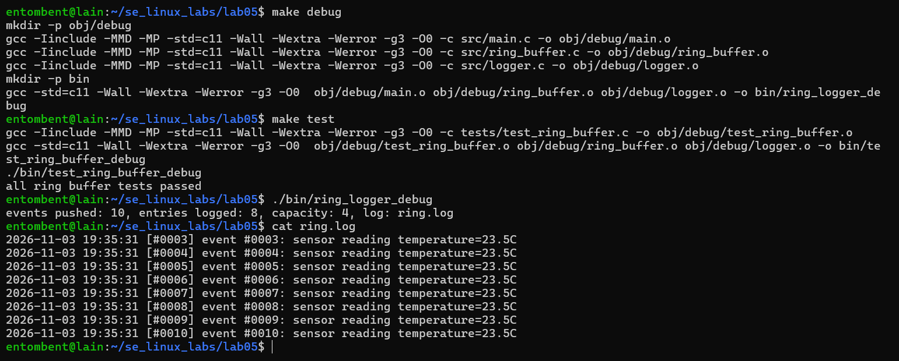
Крок 7. Конфігурація CMake та збірка:
Файл CMakeLists.txt:
```cmake
cmake_minimum_required(VERSION 3.20)
project(ring-logger
        VERSION 1.0.0
        DESCRIPTION "Ring buffer event logger"
        LANGUAGES C)

set(CMAKE_C_STANDARD 11)
set(CMAKE_C_STANDARD_REQUIRED ON)
set(CMAKE_C_EXTENSIONS OFF)

if(NOT CMAKE_BUILD_TYPE)
    set(CMAKE_BUILD_TYPE Release)
endif()

option(ENABLE_ASAN "Build with AddressSanitizer" OFF)
option(ENABLE_RING_BUG "Compile in the ring buffer defect" OFF)

add_library(ringbuf STATIC src/ring_buffer.c src/logger.c)
target_include_directories(ringbuf PUBLIC include)
target_compile_options(ringbuf PUBLIC -Wall -Wextra -Werror -g3)

if(ENABLE_RING_BUG)
    target_compile_definitions(ringbuf PRIVATE RING_BUG)
endif()

if(ENABLE_ASAN)
    target_compile_options(ringbuf PUBLIC -fsanitize=address -fno-omit-frame-pointer)
    target_link_options(ringbuf PUBLIC -fsanitize=address)
endif()

add_executable(ring_logger src/main.c)
target_link_libraries(ring_logger PRIVATE ringbuf)

enable_testing()
add_executable(test_ring_buffer tests/test_ring_buffer.c)
target_link_libraries(test_ring_buffer PRIVATE ringbuf)
add_test(NAME ring_buffer COMMAND test_ring_buffer)

include(GNUInstallDirs)
install(TARGETS ring_logger RUNTIME DESTINATION ${CMAKE_INSTALL_BINDIR})

set(CPACK_GENERATOR "DEB")
set(CPACK_PACKAGE_NAME "ring-logger")
set(CPACK_PACKAGE_VERSION "${PROJECT_VERSION}")
set(CPACK_PACKAGE_DESCRIPTION_SUMMARY "${PROJECT_DESCRIPTION}")
set(CPACK_DEBIAN_PACKAGE_MAINTAINER "Dmytro Lahoda (IPZ-23-5)")
set(CPACK_DEBIAN_PACKAGE_SECTION "utils")
set(CPACK_DEBIAN_FILE_NAME DEB-DEFAULT)
set(CPACK_DEBIAN_PACKAGE_SHLIBDEPS ON)
include(CPack)
```
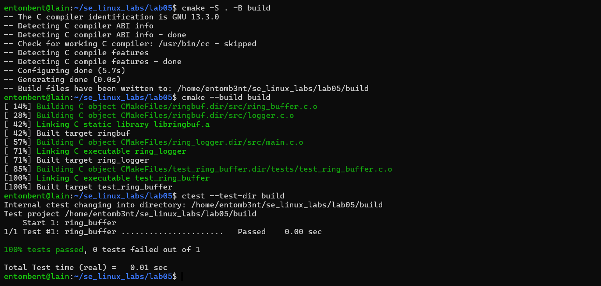
Крок 8. Пакетування через CPack та тестування DEB-пакету:
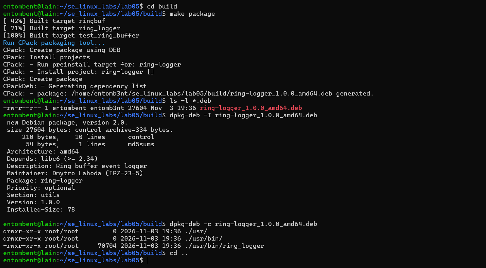
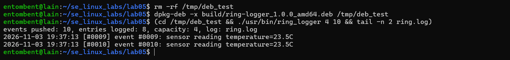
Крок 9. Налагодження в GDB:
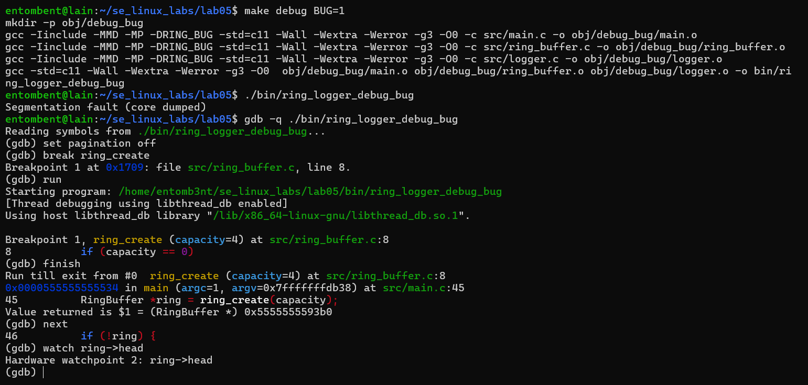
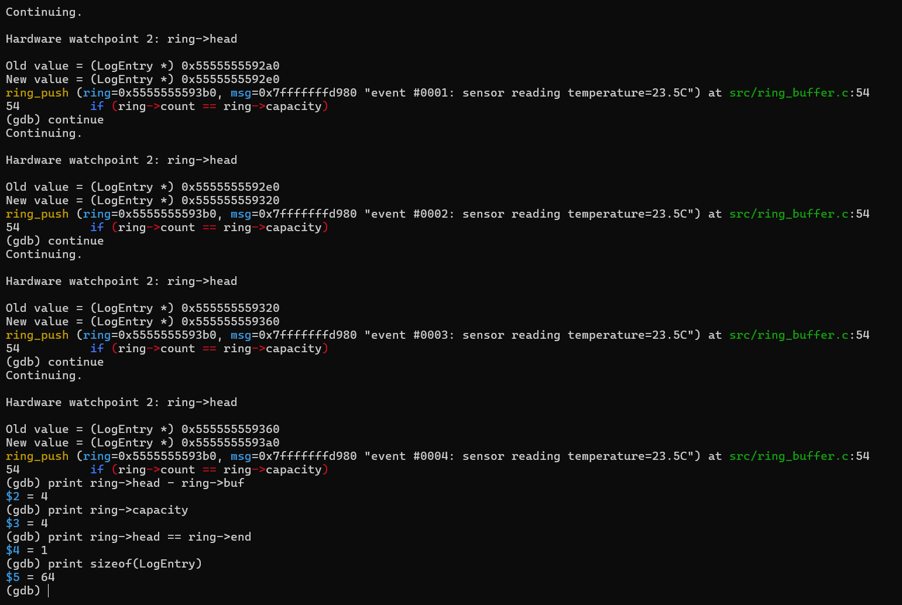
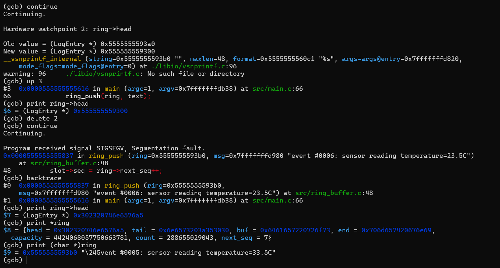
Крок 10. Динамічний аналіз пам'яті (Valgrind та ASan):
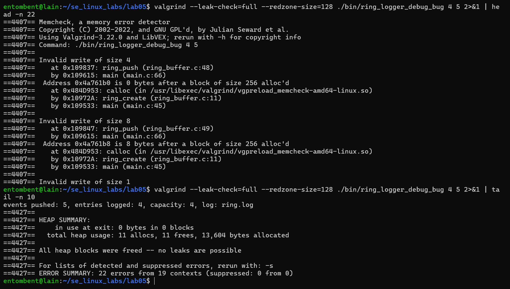
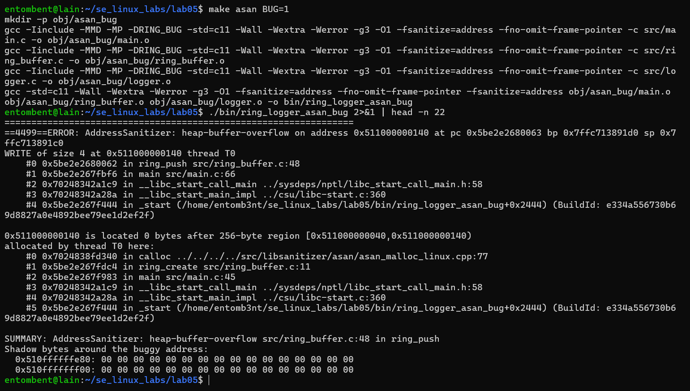
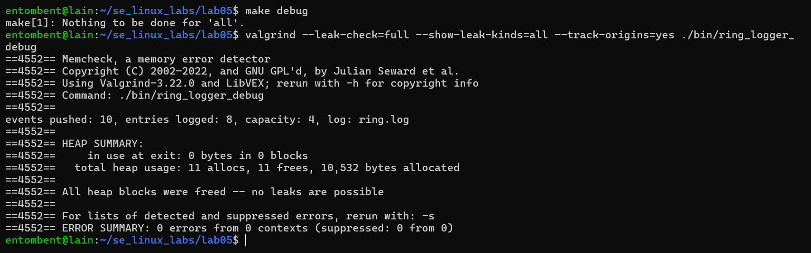
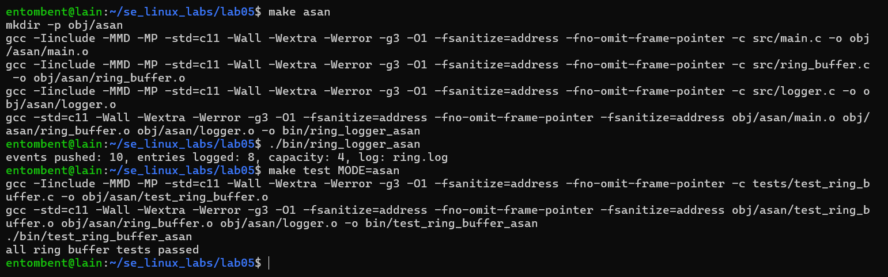
Крок 11. Трасування системних викликів у strace:
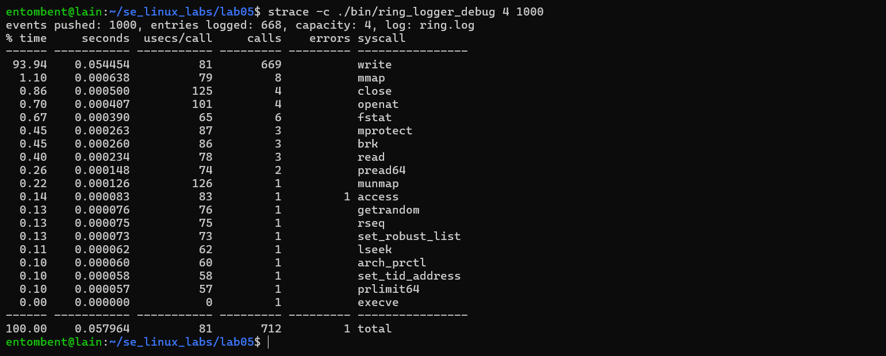
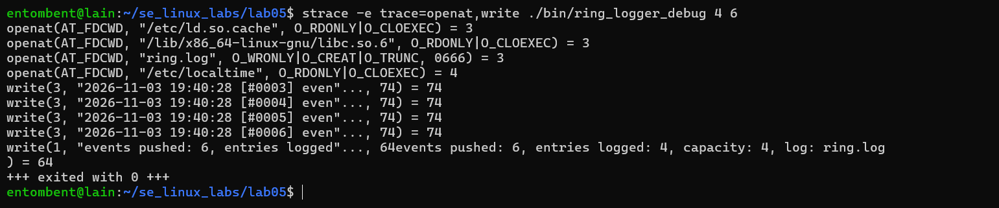

## 5. Відповіді на контрольні запитання
1. Чому для налагодження в GDB програму необхідно збирати з прапорцями `-g3` та `-O0`?
Прапорець `-g3` додає максимальну кількість налагоджувальних символів стандарту DWARF (включаючи макроси та статичні змінні), а `-O0` вимикає оптимізацію компілятора, запобігаючи інлайнінгу функцій та перевпорядкуванню інструкцій, що забезпечує точне відображення рядків коду та значень змінних.
2. Яку роль відіграють цілі `.PHONY` у файлах Makefile?
Цілі `.PHONY` явно вказують GNU Make, що вказані імена є псевдоцілями, а не реальними файлами на дисках. Це гарантує, що команди для цих цілей виконуватимуться завжди при виклику, незалежно від наявності однойменного файлу в теці.
3. Чим відрізняється робота мета-генератора CMake від класичної утиліти Make?
Make є безпосереднім виконавцем команд збірки на основі локальних Makefile, тоді як CMake є мета-генератором, який читає крос-платформні `CMakeLists.txt` та генерує на їх основі нативні файли збірки (наприклад, файли для Make або Ninja).
4. Які типи помилок пам'яті виявляє Valgrind Memcheck і як інтерпретувати статус "Definitely lost"?
Valgrind Memcheck виявляє витоки пам'яті, неініціалізоване читання, використання пам'яті після звільнення та виходи за межі буферів. Статус "Definitely lost" означає, що блок динамічної пам'яті був виділений, але на момент завершення програми до нього немає жодного активного вказівника, тобто це гарантований витік пам'яті.
5. Що таке AddressSanitizer і які переваги він має перед Valgrind за швидкістю виконання?
AddressSanitizer (ASan) — це компіляторний інструмент інструменталізації пам'яті, який вбудовує перевірки безпосередньо у виконуваний код під час компіляції. На відміну від Valgrind, який запускає код у віртуальній машині та уповільнює виконання в десятки разів, ASan сповільнює програму лише у 2–3 рази.
6. Для чого призначена утиліта strace і як отримати статистику системних викликів за допомогою ключа `-c`?
Утиліта `strace` призначена для перехоплення та трасування системних викликів, які виконує процес, а також сигналів ядра. Ключ `-c` вимикає детальний вивід кожного виклику та підсумовує статистику часу виконання, кількості викликів та помилок для кожного системного виклику у вигляді зведеної таблиці.

## 6. Висновки
Опановано інструменти автоматизації збірки Make та CMake, низькорівневе налагодження в GDB та динамічний аналіз пам'яті.
1. Створено мультимодульний проєкт із залученням бібліотеки циркулярного буфера, логера та модульних тестів, збірку якого налаштовано через Make та CMake із підтримкою пакетування CPack.
2. За допомогою GDB, Valgrind та AddressSanitizer виявлено та локалізовано дефект пам'яті (Memory Corruption через некоректний перехід вказівника у циклічному буфері).
3. Проведено системне трасування процесів через `strace`, підтверджено відсутність витоків пам'яті та коректність роботи скомпільованого DEB-пакету.

## 7. Список використаних джерел
1. Peter Jay Salzman, Michael Burian. *The Art of Debugging with GDB, DDD, and Eclipse*. No Starch Press.
2. Robert Love. *Linux System Programming*.
3. Valgrind User Manual: [https://valgrind.org/docs/manual/manual.html](https://valgrind.org/docs/manual/manual.html)
4. Linux Manual Pages: System Documentation & Reference Guides // The Linux man-pages project. — URL: [https://man7.org/linux/man-pages/](https://man7.org/linux/man-pages/)
