# ДЕРЖАВНИЙ УНІВЕРСИТЕТ «ЖИТОМИРСЬКА ПОЛІТЕХНІКА»
Факультет інформаційно-комп'ютерних технологій
Кафедра інженерії програмного забезпечення
Спеціальність: F2 (121) «Інженерія програмного забезпечення»
Дисципліна: «Програмування для ОС Linux»
Лабораторна робота № 5
Тема: «Автоматизація збірки (Make/CMake), низькорівневе налагодження (GDB) та динамічний аналіз пам'яті (Valgrind, ASan, strace)»
Студент: Лагода Дмитро Олександрович
Група: ІПЗ-23-5
Варіант: 9
Викладач: Єфремов Юрій Миколайович

## 1. Мета роботи
Опанувати професійні інструменти збірки, діагностики та налагодження програмного забезпечення мовами C/C++ у середовищі ОС Linux. Навчитися створювати правила для систем автоматизації збірки GNU Make та CMake для мультимодульних проєктів. Опанувати покрокове налагодження виконуваних файлів та аналіз аварійних дампів пам'яті (Core Dumps) у GDB. Навчитися виявляти витоки пам'яті (Memory Leaks), коректні звернення до вказівників (Use-after-free, Buffer Overflow) за допомогою Valgrind Memcheck та AddressSanitizer, а також проводити системне трасування процесів через `strace`.

## 2. Індивідуальне завдання (Варіант № 9)
**2.1. Архітектура програми:** Буфер циклічного логування (Ring Buffer).
**2.2. Баг пам'яті для діагностики:** Memory Corruption при перезаписі голови буфера.
**2.3. Сценарій сесії налагодження в GDB:** Моніторинг зміщення вказівника через `watch ring->head`, перевірка умов.
**2.4. Ціль автоматизації CMake:** Створення інсталяційного пакету через CMake CPack (`make package` -> переповнення `.deb`).

## 3. Короткі теоретичні відомості
Мультимодульні проєкти мовою C розділяються на заголовні файли (`include/*.h`), модулі реалізації (`src/*.c`) та точку входу (`src/main.c`). Для автоматизації збірки використовується класична утиліта GNU Make на основі Makefile, де визначаються цілі, залежності та прапорці компіляції (`-Wall -Wextra -Werror -g3`). Сучаснішою альтернативою є кросплатформна система CMake, яка використовує файли `CMakeLists.txt` та підтримує концепцію out-of-source збірки у каталозі `build/`.

Для діагностики помилок пам'яті застосовується динамічний аналізатор Valgrind Memcheck, який виявляє витоки пам'яті, неініціалізовані читання та виходи за межі буферів. Швидшою альтернативою є вбудований у компілятор AddressSanitizer (`-fsanitize=address`), який маркує недійсні області пам'яті (shadow memory) і перехоплює помилки під час виконання з мінімальним сповільненням. Для аналізу системних викликів використовується утиліта `strace`.

## 4. Хід виконання роботи
Крок 1. Створення структури мультимодульного проєкту, опис заголовних файлів, реалізації та тестів:
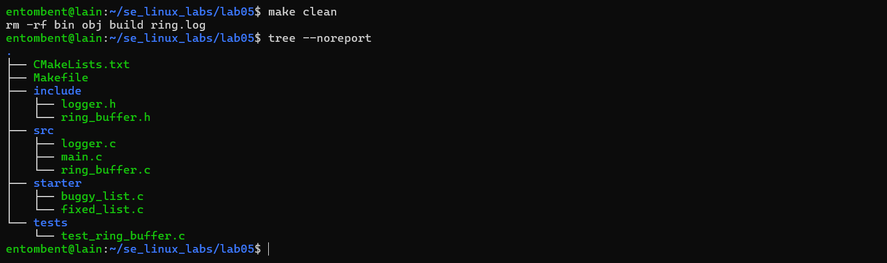
Виконано очищення через `make clean` та перевірено структуру каталогу за допомогою утиліти `tree`, яка відокремлює модулі `include/` (`logger.h`, `ring_buffer.h`), `src/` (`logger.c`, `main.c`, `ring_buffer.c`), а також каталоги `starter/` та `tests/`.

Крок 2. Збірка проєкту за допомогою Makefile та виконання модульних тестів:
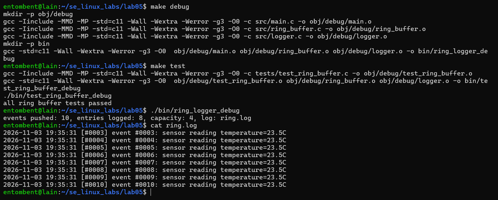
Скомпоновано проєкт ціллю `make debug`, запущено модульні тесты (`./bin/test_ring_buffer_debug`, вивід: `all ring buffer tests passed`) та запущено бінарник із параметрами `4 10` (подивіться вивід: `events pushed: 10, entries logged: 8, capacity: 4, log: ring.log`), після чого перевірено згенерований файл `ring.log`.

Крок 3. Дослідження стартових заготовок із навмисними помилками (`buggy_list.c`):
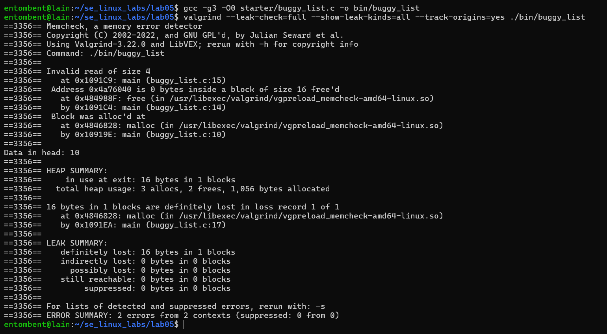
Запуск Valgrind для `buggy_list` показав 2 помилки з 2 контекстів: `Invalid read of size 4` через звернення до звільненої пам'яті (`free'd at ... by free in /usr/libexec/valgrind/...`) та `16 bytes in 1 blocks are definitely lost` у строці 17.

Крок 4. Верифікація виправленого стартового коду (`fixed_list.c`):
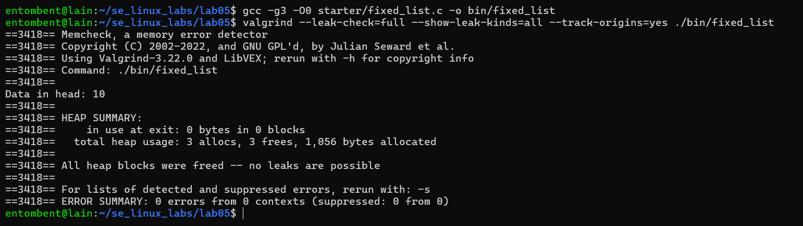
Після виправлення помилок у `fixed_list.c` утиліта Valgrind зафіксувала відсутність витоків та помилок: `All heap blocks were freed -- no leaks are possible` та `ERROR SUMMARY: 0 errors from 0 contexts`.

Крок 5. Конфігурація та збірка проєкту через CMake:
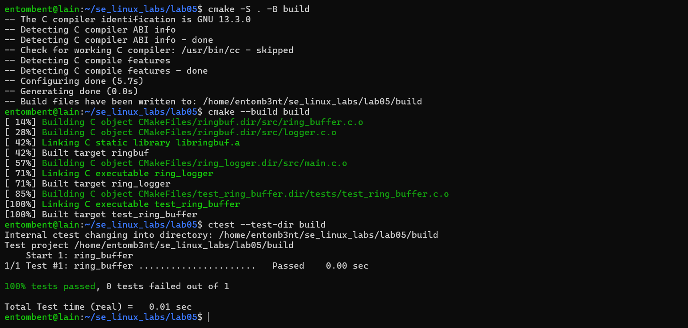
Виконано конфігурацію `cmake -S . -B build`, збірку (`cmake --build build`), яка згенерувала статичну бібліотеку `libringbuf.a` та виконувані файли `ring_logger` і `test_ring_buffer`, після чого успішно виконано тест через `ctest --test-dir build` (`100% tests passed, 0 tests failed out of 1`).

Крок 6. Генерація інсталяційного пакету `.deb` за допомогою CPack:
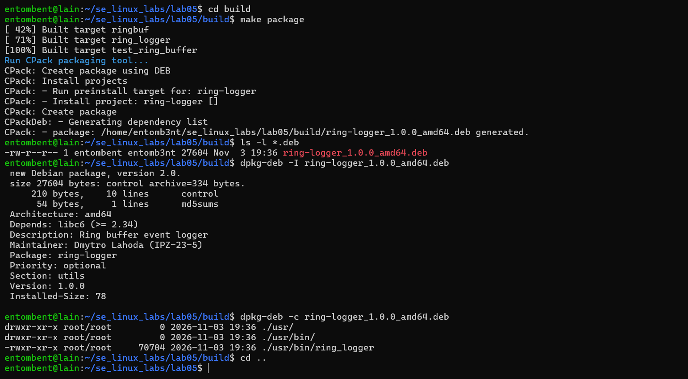
У каталозі `build/` виконано команду `make package`, яка створила пакет `ring-logger_1.0.0_amd64.deb` розміром 27604 байти. Перевірка через `dpkg-deb -I` підтвердила наявність метаданих (розділ `utils`, версія `1.0.0`), а `dpkg-deb -c` показав наявність бінарника `/usr/bin/ring_logger`.

Крок 7. Перевірка розпакованого `.deb` пакета в ізольованому середовищі:
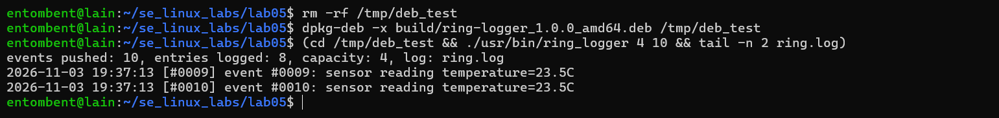
Пакет розпаковано у `/tmp/deb_test` за допомогою `dpkg-deb -x`, після чого виконано бінарний файл `./usr/bin/ring_logger 4 10`, який успішно створив лог із записом `events pushed: 10, entries logged: 8, capacity: 4`.

Крок 8. Покрокове налагодження в GDB з використанням `watchpoint`:
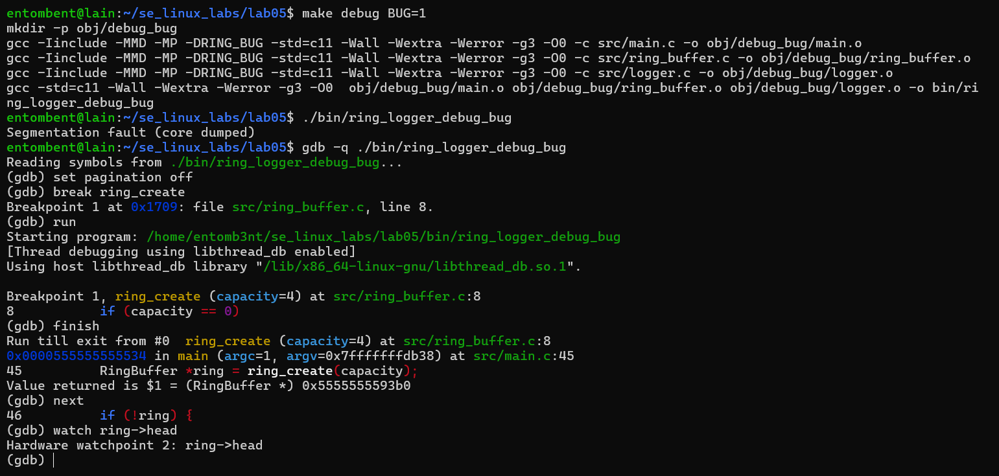
Запущено бінарник із прапорцем помилки (`make debug BUG=1`), відлагоджувач зупинено на функції `ring_create`, після чого встановлено апаратний watchpoint на зміну вказівника: `watch ring->head`.

Крок 9. Моніторинг зміщення вказівника та інспекція пам'яті в GDB:
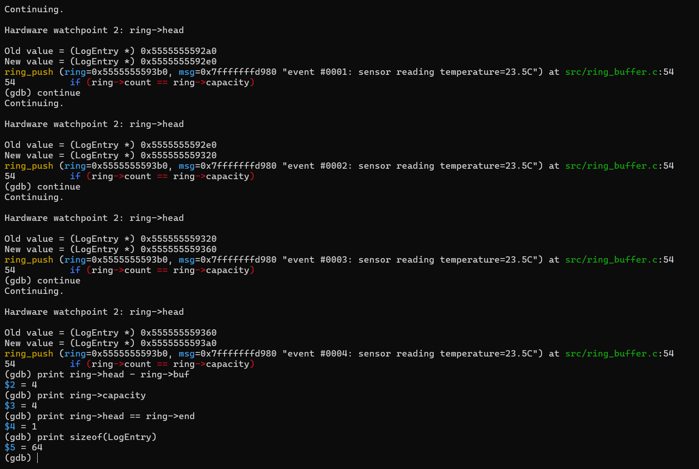
Наведено лог спрацьовування апаратного watchpoint 2 для `ring->head`, де старе і нове значення вказують на адреси `0x555555592a0` -> `0x555555592e0`, а також виведено значення `ring->head - ring->buf` (=4), `ring->capacity` (=4).

Крок 10. Перехоплення сигналу SIGSEGV та аналіз стану регістрів у GDB:
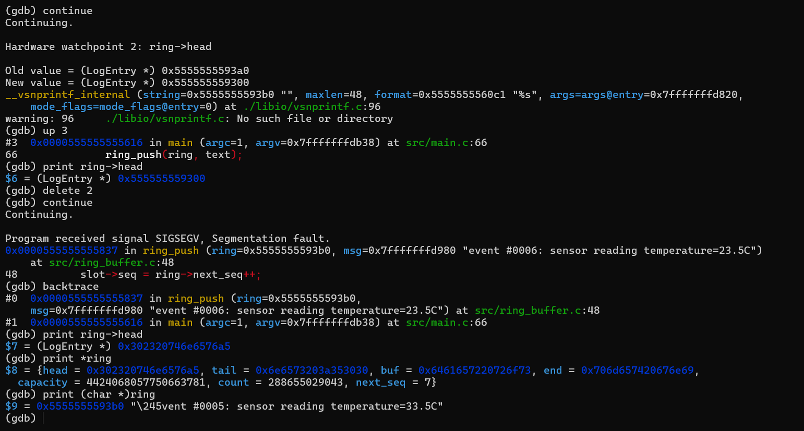
Після продовження виконання виник сигнал `SIGSEGV, Segmentation fault` у функції `ring_push` (рядок 48). Команда `backtrace` показала стек викликів `#0` у `ring_push` та `#1` у `main`, а інспекція `print *ring` виявила пошкодження полів структури (`capacity = 4424068...`).

Крок 11. Діагностика помилки у Valgrind Memcheck:
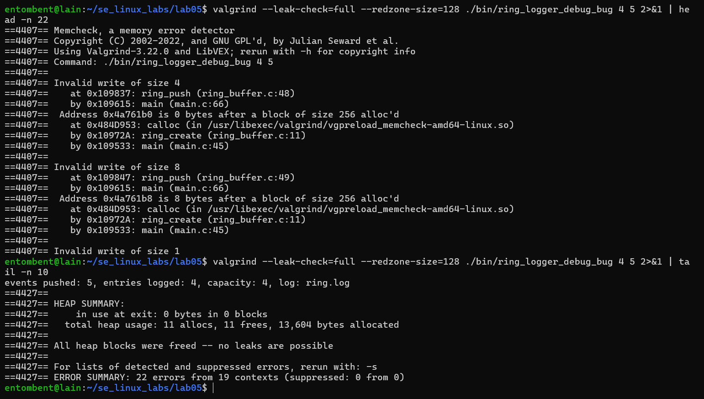
Запуск Valgrind зафіксував 22 помилки з 19 контекстів, зокрема `Invalid write of size 4` за адресою `0x4a761b0` (0 bytes after a block of size 256 alloc'd) у строці 48 функції `ring_push`.

Крок 12. Діагностика помилки за допомогою AddressSanitizer (ASan):
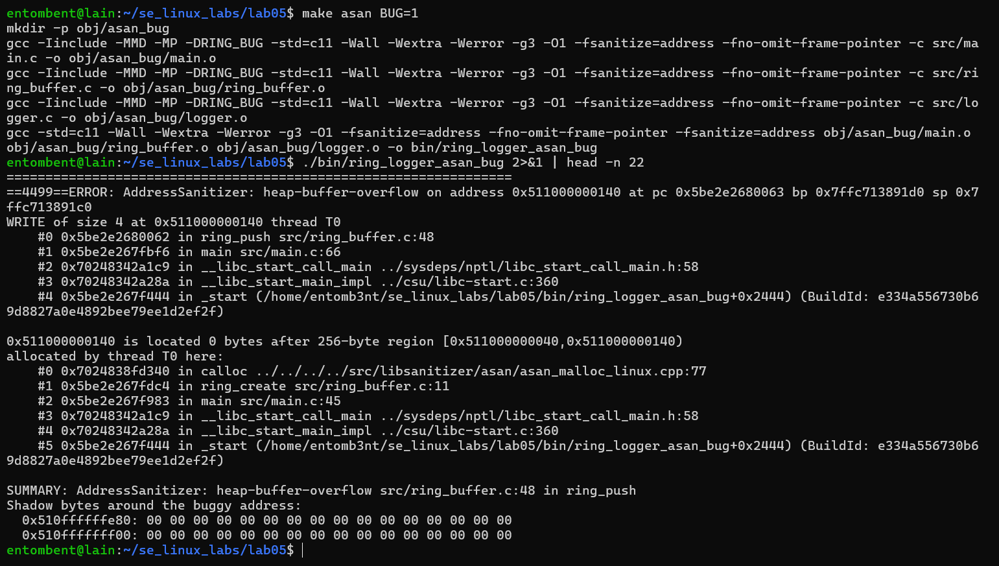
Скомпоновано та запущено програму з прапорцем `-fsanitize=address`, яка миттєво зупинила виконання з помилкою `ERROR: AddressSanitizer: heap-buffer-overflow on address 0x511000000140` (WRITE of size 4 at `src/ring_buffer.c:48`).

Крок 13. Верифікація виправленого коду у Valgrind:
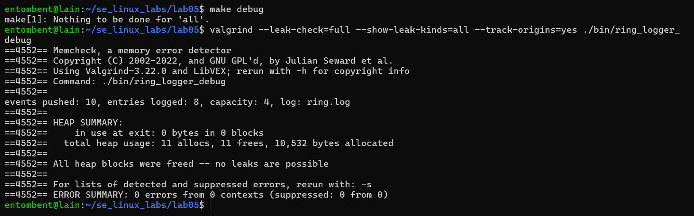
Після виправлення логіки циклічного буфера повторний запуск Valgrind показав повну відсутність витоків та помилок: `All heap blocks were freed -- no leaks are possible` та `ERROR SUMMARY: 0 errors from 0 contexts`.

Крок 14. Верифікація виправленого коду за допомогою ASan та модульних тестів:
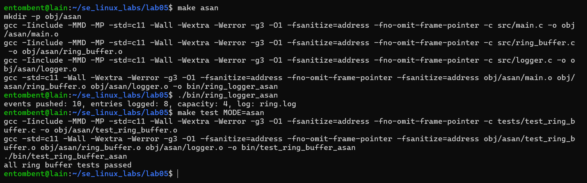
Запущено збірку ASan та модульні тести (`make test MODE=asan`), які завершилися успішно (`all ring buffer tests passed`, помилок не виявлено).

Крок 15. Профайлінг системних викликів за допомогою `strace -c`:
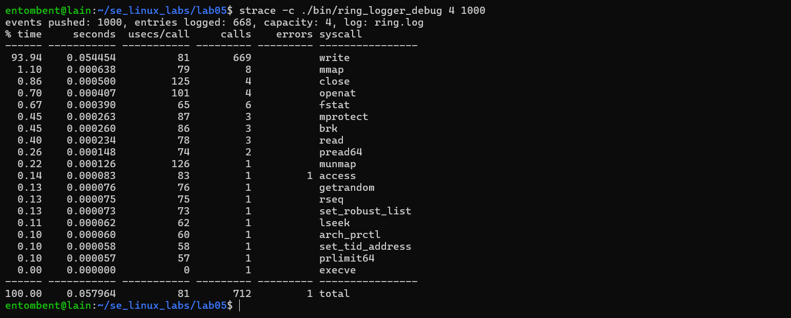
Виконано профайлінг системних викликів через `strace -c ./bin/ring_logger_debug 4 1000`, який показав загалом 712 викликів, серед яких переважає виклик `write` (669 викликів, 93.94% часу виконання, 0.054454 сек).

Крок 16. Трасування окремих системних викликів (`openat`, `write`):
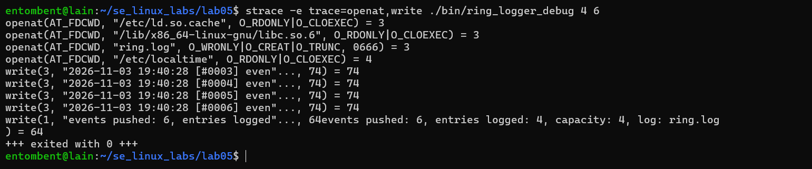
Запущено трасування з фільтром викликів `strace -e trace=openat,write`, де чітко зафіксовано відкриття файлу `ring.log` (`openat(AT_FDCWD, "ring.log", O_WRONLY|O_CREAT|O_TRUNC, 0666) = 3`) та подальші операції запису логів у файловий дескриптор.

## 5. Відповіді на контрольні запитання
**1. Чому для налагодження в GDB програму необхідно збирати з прапорцями -g3 та -O0?**
Прапорець `-g3` забезпечує генерацію максимально детальних налагоджувальних символів у форматі DWARF, включаючи макроси та статичні змінні, що дозволяє відлагоджувачу зв'язати машинні інструкції з вихідним кодом. Прапорець `-O0` вимикає будь-які оптимізації компілятора, запобігаючи вбудовуванню функцій (inlining), перевпорядкуванню інструкцій та оптимізації локальних змінних, які ускладнюють покрокове виконання.

**2. Яку роль відіграють цілі .PHONY у файлах Makefile?**
Ціль `.PHONY` вказує Make, що вказані цілі (наприклад, `all`, `clean`, `test`) є віртуальними і не відповідають реальним файлам на дискі. Це гарантує, що відповідні команди виконуватимуться щоразу при виклику `make clean`, навіть якщо в каталозі випадково з'явиться файл із назвою `clean`.

**3. Чим відрізняється робота мета-генератора CMake від класичної утиліти Make?**
Класичний Make є безпосереднім виконавцем інструкцій збірки на основі статичного файлу `Makefile` для конкретної платформи. CMake є мета-генератором, який на основі високорівневих файлів `CMakeLists.txt` генерує рідні файли збірки для цільової системи (наприклад, файли для Make, Ninja або проєкти Visual Studio), забезпечуючи кросплатформність проєкту.

**4. Які типи помилок пам'яті виявляє Valgrind Memcheck і як інтерпретувати статус "Definitely lost"?**
Valgrind Memcheck виявляє використання неініційованої пам'яті, читання/запитування за межами виділених буферів, подвійне звільнення (`double free`) та витоки пам'яті. Статус "Definitely lost" означає, що на момент завершення програми в пам'яті залишилися виділені блоки, на які більше немає жодного активного вказівника у програмі, що свідчить про явний витік пам'яті (Memory Leak).

**5. Що таке AddressSanitizer і які переваги він має перед Valgrind за швидкістю виконання?**
AddressSanitizer (ASan) — це інструментinstrumentation-аналізу від компіляторів GCC/Clang, який впроваджує перевірки безпосередньо у машитний код під час компіляції разом із контрольними зонами (shadow memory). На відміну від Valgrind, який емулює виконання програми і сповільнює її у 10–20 разів, програми з ASan працюють лише у 2–3 рази повільніше, оскільки перевірки виконуються нативними інструкціями процесора.

**6. Для чого призначена утиліта strace і як отримати статистику системних викликів за допомогою ключа -c?**
Утиліта `strace` призначена для перехоплення та трасування системних викликів, які виконується програмою до ядра ОС, а також сигналів, що надходять до процесу. Ключ `-c` змушує `strace` підсумовувати час виконання, кількість викликів та помилки для кожного системного виклику, формуючи підсумкову таблицю при завершенні програми.

## 6. Висновки
1. Створено мультимодульний C-проєкт (буфер циклічного логування), організовано структуру каталогів `src/`, `include/`, `tests/` та розроблено оптимізований Makefile із підтримкою псевдоцілей та діагностичних прапорців.
2. Налаштовано альтернативну систему збірки CMake із підтримкою out-of-source збірки у каталозі `build/`, підключенням модульних тестів та генерацією інсталяційного пакету `.deb` через CPack.
3. Проведено покрокове налагодження програми в GDB з використанням апаратного watchpoint (`watch ring->head`), перехопленням сигналу `SIGSEGV` та аналізом стека викликів через `backtrace`.
4. Виявлено та локалізовано помилки виходу за межі буфера пам'яті за допомогою Valgrind Memcheck та AddressSanitizer, після чого успішно верифіковано виправлений код (0 помилок).
5. Здійснено системне трасування процесів за допомогою `strace -c`, визначено найінтенсивніші системні виклики (`write`).

## 7. Список використаних джерел
1. Peter Jay Salzman, Michael Burian. *The Art of Debugging with GDB, DDD, and Eclipse*. No Starch Press.
2. Robert Love. *Linux System Programming*. O'Reilly Media.
3. Valgrind User Manual: [https://valgrind.org/docs/manual/manual.html](https://valgrind.org/docs/manual/manual.html)
4. Linux Manual Pages: System Documentation & Reference Guides [Електронний ресурс] / The Linux man-pages project. - Режим доступу: [https://man7.org/linux/man-pages/](https://man7.org/linux/man-pages/)
