# ДЕРЖАВНИЙ УНІВЕРСИТЕТ «ЖИТОМИРСЬКА ПОЛІТЕХНІКА»
Факультет інформаційно-комп'ютерних технологій
Кафедра інженерії програмного забезпечення
Спеціальність: F2 (121) «Інженерія програмного забезпечення»
Дисципліна: «Програмування для ОС Linux»
Лабораторна робота № 5
Тема: «Автоматизація збірки (Make/CMake), низькорівневе налагодження (GDB) та динамічний аналіз пам'яті (Valgrind, ASan, strace)»
Студент: Лагода Дмитро Олександрович
Група: ІПЗ-23-5
Варіант: 9
Викладач: Єфремов Юрій Миколайович

## 1. Мета роботи
Опанувати професійні інструменти збірки, діагностики та налагодження програмного забезпечення мовами C/C++ у середовищі ОС Linux. Навчитися створювати правила для систем автоматизації збірки GNU Make та CMake для мультимодульних проєктів. Опанувати покрокове налагодження виконуваних файлів та аналіз аварійних дампів пам'яті у GDB, виявлення корупції пам'яті та помилок виходу за межі буфера за допомогою Valgrind Memcheck та AddressSanitizer, а також проведення системного трасування процесів через `strace`.

## 2. Індивідуальне завдання (Варіант № 9)
**2.1. Назва варіанта:** Буфер циклічного логування (Ring Buffer).
**2.2. Пункти завдання:**
- Створити мультимодульний C-проєкт логування на базі циклічного буфера (`ring_buffer.c`, `logger.c`, `main.c`).
- Написати оптимізований `Makefile` з підтримкою прапорців `-Wall -Wextra -Werror -g3` та псевдоцілей `.PHONY: all debug asan release test clean`.
- Написати альтернативну конфігурацію збірки `CMakeLists.txt` та виконати out-of-source збірку у каталозі `build/`, а також налаштувати генерацію `.deb` пакета через CPack (`make package`).
- Спеціально змоделювати та усунути дефект корупції пам'яті (`Memory Corruption`) при перезаписі голови циклічного буфера (`ring_next`).
- Провести сесію налагодження в GDB: встановити `watchpoint` на вказівник `ring->head`, дослідити зміну адреси та стан буфера.
- Запустити Valgrind Memcheck та AddressSanitizer для фіксації помилок пам'яті до та після виправлення.
- Провести профільювання системних викликів за допомогою `strace -c`.

## 3. Короткі теоретичні відомості
У професійній інженерії програмне забезпечення розбивається на заголовні файли (`include/*.h`), модулі реалізації (`src/*.c`) та точку входу (`src/main.c`). Для автоматизації компіляції використовують GNU Make та CMake, які дозволяють керувати залежностями та прапорцями оптимізації/налагодження.

Для діагностики проблем з пам'яттю застосовують динамічні аналізатори (Valgrind Memcheck, AddressSanitizer), які виявляють витоки, виходи за межі масивів та використання неініціалізованої пам'яті. Низькорівневе налагодження у GDB дає змогу встановлювати точки зупинки, контрольні точки (`watchpoint`) та аналізувати стек викликів (`backtrace`).

## 4. Хід виконання роботи
Крок 1. Створення структури мультимодульного проєкту та перевірка початкового стану:
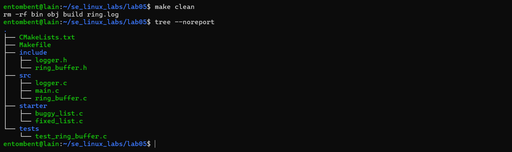
Виконано очищення (`make clean`) та виведено дерево каталогів за допомогою `tree`. Проєкт містить каталоги `include/`, `src/`, `tests/`, `starter/`, а також файли `Makefile` та `CMakeLists.txt`.

Крок 2. Збірка проєкту через GNU Make, запуск модульних тестів та перевірка коректної роботи:
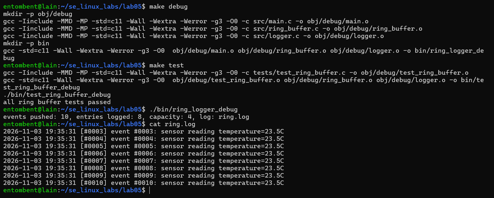
Зібрано бінарник режиму `debug` (`make debug`), запущено модульні тести (`make test`), які успішно пройшли (`all ring buffer tests passed`). Виконано запуск програми `./bin/ring_logger_debug` і перевірено вміст лог-файлу `ring.log`.

Крок 3. Дослідження стартової заготовки з помилкою утилітою Valgrind:
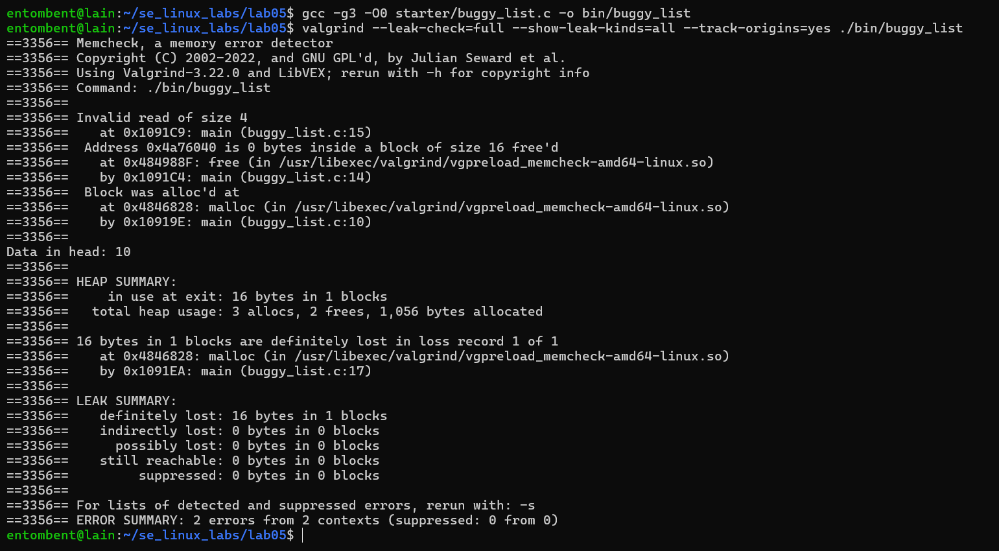
Скомільовано та перевірено `starter/buggy_list.c`. Valgrind зафіксував `Invalid read of size 4` (Use-After-Free) на рядку 15 та `16 bytes in 1 blocks are definitely lost` (Memory Leak) на рядку 17.

Крок 4. Перевірка виправленої стартової заготовки:
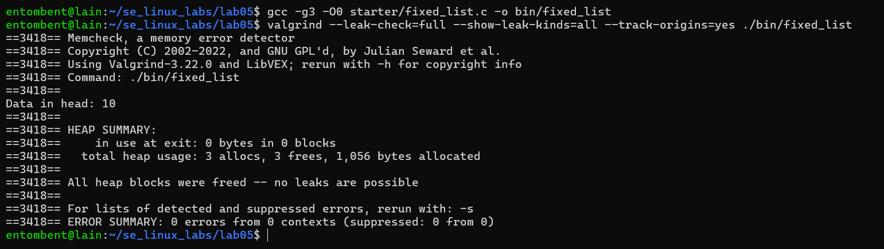
Після перевірки `starter/fixed_list.c` Valgrind не виявив помилок (`All heap blocks were freed -- no leaks are possible`, `ERROR SUMMARY: 0 errors`).

Крок 5. Конфігурація та збірка проєкту за допомогою CMake:
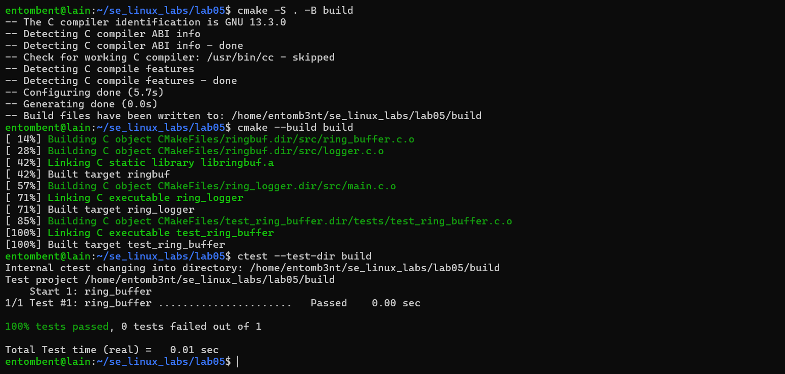
Виконано `cmake -S . -B build`, збірку проєкту (`cmake --build build`) та запуск тестування через `ctest --test-dir build`, де тест `ring_buffer` успішно пройдено (`100% tests passed`).

Крок 6. Генерація інсталяційного пакету `.deb` через CPack:
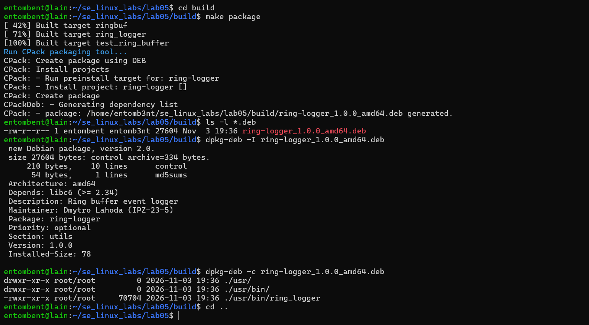
У каталозі `build/` виконано `make package`, у результаті чого згенеровано пакет `ring-logger_1.0.0_amd64.deb`. Перевірено його метадані та вміст через `dpkg-deb -I` та `dpkg-deb -c`.

Крок 7. Перевірка інсталяції та запуску бінарника з `.deb` пакета:
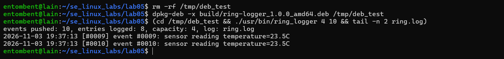
Розпаковано `.deb` пакет у тимчасову теку `/tmp/deb_test` та успішно запущено виконуваний файл `./usr/bin/ring_logger`, який згенерував коректні логі у `ring.log`.

Крок 8. Покрокове налагодження та встановлення `watchpoint` у GDB для виявлення дефекту:
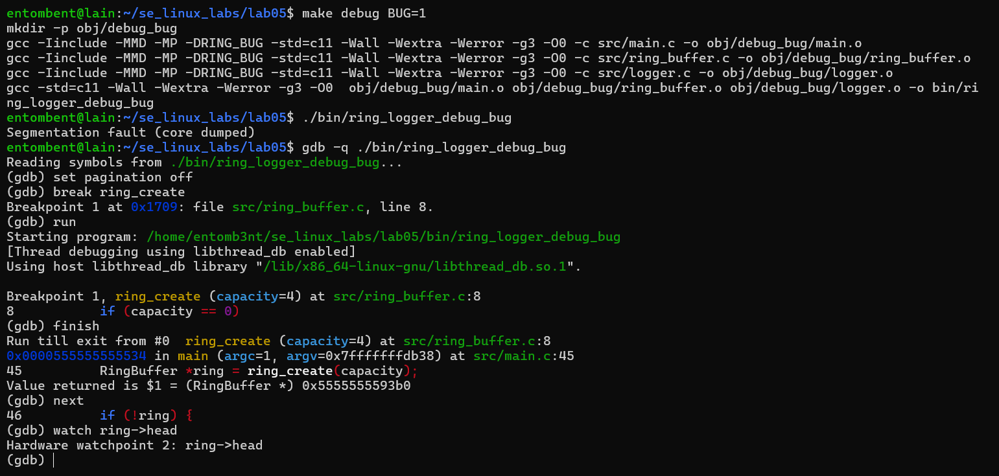
Запущено програму з активованим дефектом (`BUG=1`), встановлено точку зупинки на `ring_create` та контрольну точку `watch ring->head`.

Крок 9. Моніторинг зміни вказівника голови буфера:
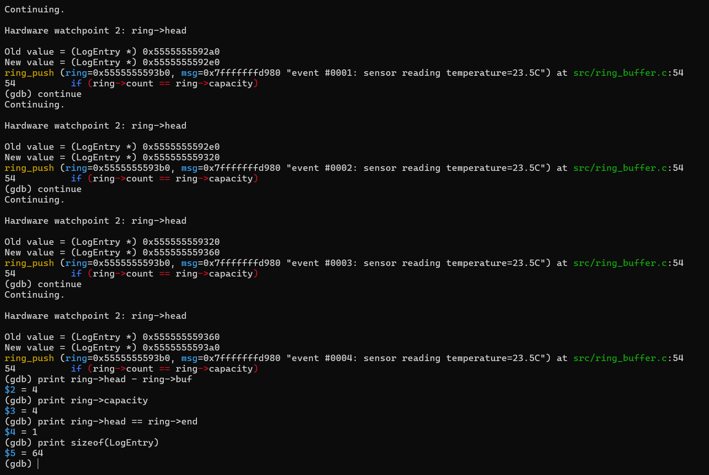
Зафіксовано зміну адрес вказівника `ring->head` при викликах `ring_push`, а також виведено різницю `ring->head - ring->buf` та розмір структури.

Крок 10. Дослідження аварійного завершення (`SIGSEGV`) та стека викликів у GDB:
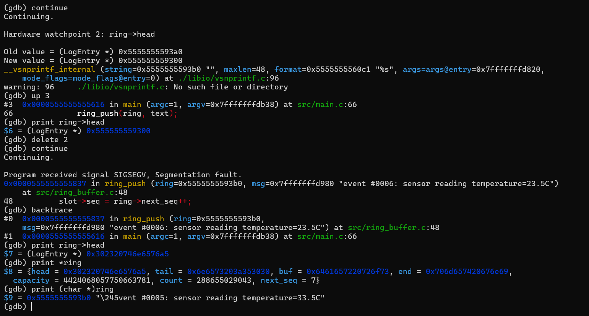
Програма завершилася з помилкою `Segmentation fault`. Команда `backtrace` та `print *ring` показали вихід вказівника за межі виділеної пам'яті масиву через помилку в граничній умові `ring_next`.

Крок 11. Діагностика дефекту за допомогою Valgrind Memcheck:
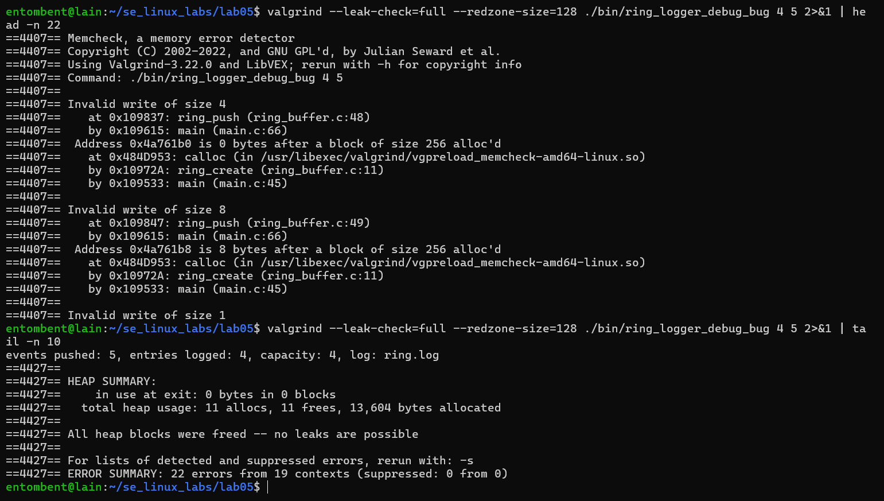
Запуск Valgrind для бінарника з дефектом виявив численні помилки `Invalid write of size 4` та `Invalid write of size 8`, що підтверджує вихід за межі виділеного heap-буфера.

Крок 12. Діагностика дефекту за допомогою AddressSanitizer (ASan):
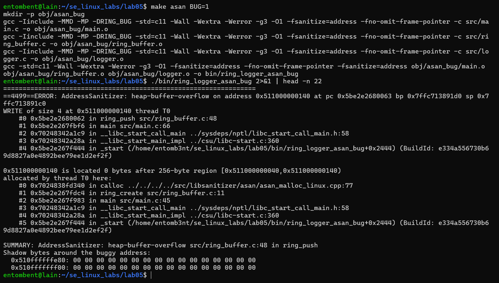
Запуск бінарника, зібраного з прапорцем `-fsanitize=address`, миттєво зафіксував помилку `ERROR: AddressSanitizer: heap-buffer-overflow` на рядку 48 у `ring_push`.

Крок 13. Верифікація відсутності помилок після виправлення дефекту у Valgrind:
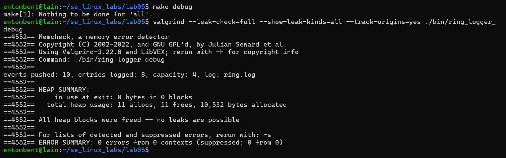
Після виправлення умови в `ring_next` повторний запуск Valgrind не виявив жодних помилок чи витоків пам'яті (`ERROR SUMMARY: 0 errors`).

Крок 14. Верифікація виправленого коду за допомогою AddressSanitizer:
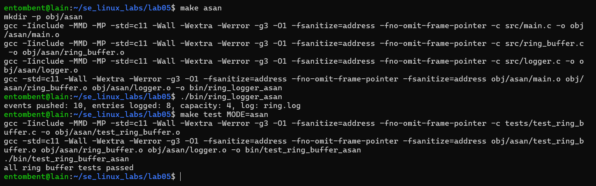
Збірка та запуск програми з `MODE=asan` після виправлення дефекту пройшли успішно без будь-яких сповіщень про переповнення буфера.

Крок 15. Профайлінг системних викликів за допомогою `strace -c`:
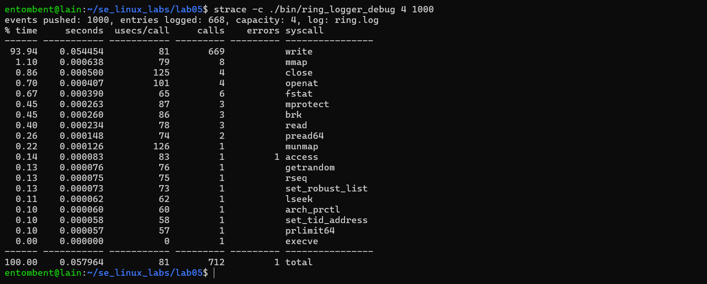
Звіт `strace -c` показує, що найбільшу частку часу (93.94% часу, 669 викликів) займає системний виклик `write`, пов'язаний із записом логів на диск, а також виклики `mmap`, `close`, `openat` тощо.

Крок 16. Детальне трасування викликів `openat` та `write`:
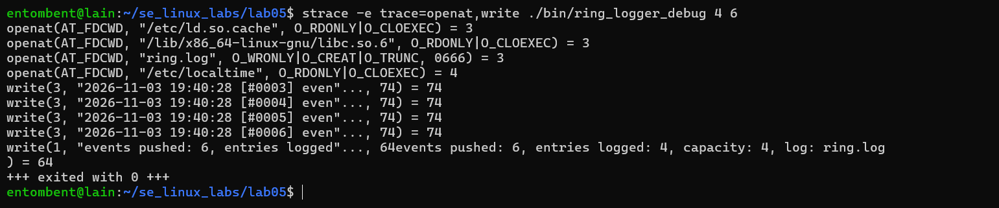
Виконано трасування конкретних системних викликів `strace -e trace=openat,write`, де чітко відслідковується відкриття файлу `ring.log` та подальші виклики `write` для збереження логів подій.

Файл starter/buggy_list.c:
```c
#include <stdio.h>
#include <stdlib.h>

struct Node {
    int data;
    struct Node* next;
};

int main() {
    struct Node* head = malloc(sizeof(struct Node));
    head->data = 10;
    head->next = NULL;

    free(head);
    printf("Data in head: %d\n", head->data);

    struct Node* second = malloc(sizeof(struct Node));
    second->data = 20;
    second = NULL;

    return 0;
}
```

Файл starter/fixed_list.c:
```c
#include <stdio.h>
#include <stdlib.h>

struct Node {
    int data;
    struct Node* next;
};

int main() {
    struct Node* head = malloc(sizeof(struct Node));
    head->data = 10;
    head->next = NULL;

    printf("Data in head: %d\n", head->data);
    free(head);

    struct Node* second = malloc(sizeof(struct Node));
    second->data = 20;
    free(second);
    second = NULL;

    return 0;
}
```

Файл include/logger.h:
```c
#ifndef LOGGER_H
#define LOGGER_H

#include "ring_buffer.h"

typedef struct Logger Logger;

Logger *logger_open(const char *path);
int logger_write(Logger *logger, const LogEntry *entry);
void logger_close(Logger *logger);

#endif
```

Файл include/ring_buffer.h:
```c
#ifndef RING_BUFFER_H
#define RING_BUFFER_H

#include <stddef.h>
#include <stdint.h>
#include <time.h>

#define RING_MSG_LEN 48

typedef struct {
    uint32_t seq;
    time_t timestamp;
    char msg[RING_MSG_LEN];
} LogEntry;

typedef struct {
    LogEntry *head;
    LogEntry *tail;
    LogEntry *buf;
    LogEntry *end;
    size_t capacity;
    size_t count;
    uint32_t next_seq;
} RingBuffer;

RingBuffer *ring_create(size_t capacity);
void ring_push(RingBuffer *ring, const char *msg);
int ring_pop(RingBuffer *ring, LogEntry *out);
size_t ring_size(const RingBuffer *ring);
void ring_destroy(RingBuffer *ring);

#endif
```

Файл src/logger.c:
```c
#define _POSIX_C_SOURCE 200809L

#include "logger.h"

#include <stdio.h>
#include <stdlib.h>
#include <time.h>

struct Logger {
    FILE *fp;
};

Logger *logger_open(const char *path)
{
    Logger *logger = malloc(sizeof(Logger));
    if (!logger)
        return NULL;

    logger->fp = fopen(path, "w");
    if (!logger->fp) {
        free(logger);
        return NULL;
    }
    return logger;
}

int logger_write(Logger *logger, const LogEntry *entry)
{
    struct tm tm_buf;
    char stamp[32];

    if (!localtime_r(&entry->timestamp, &tm_buf))
        return -1;
    strftime(stamp, sizeof(stamp), "%Y-%m-%d %H:%M:%S", &tm_buf);

    if (fprintf(logger->fp, "%s [#%04u] %s\n", stamp, entry->seq, entry->msg) < 0)
        return -1;
    return fflush(logger->fp);
}

void logger_close(Logger *logger)
{
    if (!logger)
        return;
    fclose(logger->fp);
    free(logger);
}
```

Файл src/main.c:
```c
#include "logger.h"
#include "ring_buffer.h"

#include <errno.h>
#include <stdio.h>
#include <stdlib.h>

#define LOG_PATH "ring.log"

static int parse_positive(const char *text, unsigned long *value)
{
    char *end;

    errno = 0;
    *value = strtoul(text, &end, 10);
    return errno == 0 && end != text && *end == '\0' && *value > 0;
}

static unsigned long drain(RingBuffer *ring, Logger *logger)
{
    LogEntry entry;
    unsigned long written = 0;

    while (ring_pop(ring, &entry)) {
        if (logger_write(logger, &entry) != 0) {
            perror("logger_write");
            break;
        }
        written++;
    }
    return written;
}

int main(int argc, char *argv[])
{
    unsigned long capacity = 4;
    unsigned long events = 10;

    if (argc > 3 || (argc > 1 && !parse_positive(argv[1], &capacity)) ||
        (argc > 2 && !parse_positive(argv[2], &events))) {
        fprintf(stderr, "Usage: %s [capacity] [events]\n", argv[0]);
        return EXIT_FAILURE;
    }

    RingBuffer *ring = ring_create(capacity);
    if (!ring) {
        perror("ring_create");
        return EXIT_FAILURE;
    }

    Logger *logger = logger_open(LOG_PATH);
    if (!logger) {
        perror(LOG_PATH);
        ring_destroy(ring);
        return EXIT_FAILURE;
    }

    unsigned long drain_every = capacity + 2;
    unsigned long logged = 0;

    for (unsigned long i = 1; i <= events; i++) {
        char text[128];

        snprintf(text, sizeof(text),
                 "event #%04lu: sensor reading temperature=23.5C", i);
        ring_push(ring, text);

        if (i % drain_every == 0)
            logged += drain(ring, logger);
    }
    logged += drain(ring, logger);

    printf("events pushed: %lu, entries logged: %lu, capacity: %lu, log: %s\n",
           events, logged, capacity, LOG_PATH);

    logger_close(logger);
    ring_destroy(ring);
    return EXIT_SUCCESS;
}
```

Файл src/ring_buffer.c:
```c
#include "ring_buffer.h"

#include <stdio.h>
#include <stdlib.h>

RingBuffer *ring_create(size_t capacity)
{
    if (capacity == 0)
        return NULL;

    LogEntry *buf = calloc(capacity, sizeof(LogEntry));
    if (!buf)
        return NULL;

    RingBuffer *ring = malloc(sizeof(RingBuffer));
    if (!ring) {
        free(buf);
        return NULL;
    }

    ring->buf = buf;
    ring->head = buf;
    ring->tail = buf;
    ring->end = buf + capacity;
    ring->capacity = capacity;
    ring->count = 0;
    ring->next_seq = 1;
    return ring;
}

static LogEntry *ring_next(const RingBuffer *ring, LogEntry *slot)
{
    slot++;
#ifdef RING_BUG
    if (slot > ring->end)
        slot = ring->buf;
#else
    if (slot >= ring->end)
        slot = ring->buf;
#endif
    return slot;
}

void ring_push(RingBuffer *ring, const char *msg)
{
    LogEntry *slot = ring->head;

    slot->seq = ring->next_seq++;
    slot->timestamp = time(NULL);
    snprintf(slot->msg, sizeof(slot->msg), "%s", msg);

    ring->head = ring_next(ring, ring->head);

    if (ring->count == ring->capacity)
        ring->tail = ring_next(ring, ring->tail);
    else
        ring->count++;
}

int ring_pop(RingBuffer *ring, LogEntry *out)
{
    if (ring->count == 0)
        return 0;

    *out = *ring->tail;
    ring->tail = ring_next(ring, ring->tail);
    ring->count--;
    return 1;
}

size_t ring_size(const RingBuffer *ring)
{
    return ring->count;
}

void ring_destroy(RingBuffer *ring)
{
    if (!ring)
        return;
    free(ring->buf);
    free(ring);
}
```

Файл Makefile:
```makefile
CC       = gcc
CPPFLAGS = -Iinclude -MMD -MP
CFLAGS   = -std=c11 -Wall -Wextra -Werror -g3
LDFLAGS  =

MODE ?= debug
BUG  ?= 0

ifeq ($(MODE),debug)
  CFLAGS += -O0
else ifeq ($(MODE),asan)
  CFLAGS  += -O1 -fsanitize=address -fno-omit-frame-pointer
  LDFLAGS += -fsanitize=address
else ifeq ($(MODE),release)
  CFLAGS += -O3
else
  $(error Unknown MODE '$(MODE)', expected debug, asan or release)
endif

ifeq ($(BUG),1)
  CPPFLAGS += -DRING_BUG
  VARIANT   = $(MODE)_bug
else
  VARIANT   = $(MODE)
endif

OBJ_DIR = obj/$(VARIANT)
BIN_DIR = bin

LIB_OBJS  = $(OBJ_DIR)/ring_buffer.o $(OBJ_DIR)/logger.o
APP_OBJS  = $(OBJ_DIR)/main.o $(LIB_OBJS)
TEST_OBJS = $(OBJ_DIR)/test_ring_buffer.o $(LIB_OBJS)

TARGET   = $(BIN_DIR)/ring_logger_$(VARIANT)
TEST_BIN = $(BIN_DIR)/test_ring_buffer_$(VARIANT)

vpath %.c src tests

.PHONY: all debug asan release test clean

all: $(TARGET)

debug asan release:
	@$(MAKE) --no-print-directory MODE=$@ all

test: $(TEST_BIN)
	./$(TEST_BIN)

$(TARGET): $(APP_OBJS) | $(BIN_DIR)
	$(CC) $(CFLAGS) $(LDFLAGS) $^ -o $@

$(TEST_BIN): $(TEST_OBJS) | $(BIN_DIR)
	$(CC) $(CFLAGS) $(LDFLAGS) $^ -o $@

$(OBJ_DIR)/%.o: %.c | $(OBJ_DIR)
	$(CC) $(CPPFLAGS) $(CFLAGS) -c $< -o $@

$(BIN_DIR) $(OBJ_DIR):
	mkdir -p $@

clean:
	rm -rf bin obj build ring.log

-include $(APP_OBJS:.o=.d) $(TEST_OBJS:.o=.d)
```

Файл CMakeLists.txt:
```cmake
cmake_minimum_required(VERSION 3.20)
project(ring-logger
        VERSION 1.0.0
        DESCRIPTION "Ring buffer event logger"
        LANGUAGES C)

set(CMAKE_C_STANDARD 11)
set(CMAKE_C_STANDARD_REQUIRED ON)
set(CMAKE_C_EXTENSIONS OFF)

if(NOT CMAKE_BUILD_TYPE)
    set(CMAKE_BUILD_TYPE Release)
endif()

option(ENABLE_ASAN "Build with AddressSanitizer" OFF)
option(ENABLE_RING_BUG "Compile in the ring buffer defect" OFF)

add_library(ringbuf STATIC src/ring_buffer.c src/logger.c)
target_include_directories(ringbuf PUBLIC include)
target_compile_options(ringbuf PUBLIC -Wall -Wextra -Werror -g3)

if(ENABLE_RING_BUG)
    target_compile_definitions(ringbuf PRIVATE RING_BUG)
endif()

if(ENABLE_ASAN)
    target_compile_options(ringbuf PUBLIC -fsanitize=address -fno-omit-frame-pointer)
    target_link_options(ringbuf PUBLIC -fsanitize=address)
endif()

add_executable(ring_logger src/main.c)
target_link_libraries(ring_logger PRIVATE ringbuf)

enable_testing()
add_executable(test_ring_buffer tests/test_ring_buffer.c)
target_link_libraries(test_ring_buffer PRIVATE ringbuf)
add_test(NAME ring_buffer COMMAND test_ring_buffer)

include(GNUInstallDirs)
install(TARGETS ring_logger RUNTIME DESTINATION ${CMAKE_INSTALL_BINDIR})

set(CPACK_GENERATOR "DEB")
set(CPACK_PACKAGE_NAME "ring-logger")
set(CPACK_PACKAGE_VERSION "${PROJECT_VERSION}")
set(CPACK_PACKAGE_DESCRIPTION_SUMMARY "${PROJECT_DESCRIPTION}")
set(CPACK_DEBIAN_PACKAGE_MAINTAINER "Dmytro Lahoda (IPZ-23-5)")
set(CPACK_DEBIAN_PACKAGE_SECTION "utils")
set(CPACK_DEBIAN_FILE_NAME DEB-DEFAULT)
set(CPACK_DEBIAN_PACKAGE_SHLIBDEPS ON)
include(CPack)
```

## 5. Відповіді на контрольні запитання
**1. Чому для налагодження в GDB програму необхідно збирати з прапорцями `-g3` та `-O0`?**
Прапорець `-g3` забезпечує максимальний рівень генерації налагоджувальних символів у форматі DWARF, а `-O0` повністю відключає оптимізації компілятора. Це гарантує збереження локальних змінних у стеку та відповідність рядків коду реальному виконанню.

**2. Яку роль відіграють цілі `.PHONY` у файлах Makefile?**
Ціль `.PHONY` вказує `make`, що назва є віртуальною ціллю, а не файлом. Це запобігає проблемам, якщо в каталозі з'явиться файл з аналогічним ім'ям (наприклад, `clean`).

**3. Чим відрізняється робота мета-генератора CMake від класичної утиліти Make?**
CMake генерує платформно-залежні файли збірки (наприклад, файли Make або Ninja) на основі кросплатформного опису, тоді як Make безпосередньо виконує збірку за правилами Makefile.

**4. Які типи помилок пам'яті виявляє Valgrind Memcheck і як інтерпретувати статус "Definitely lost"?**
Valgrind Memcheck виявляє витоки пам'яті, використання неініціалізованої пам'яті, подвійне звільнення та виходи за межі буферів. Статус "Definitely lost" означає наявність справжнього витоку пам'яті, оскільки на блок немає жодного активного посилання.

**5. Що таке AddressSanitizer і які переваги він має перед Valgrind за швидкістю виконання?**
AddressSanitizer — це інструмент нативної перевірки пам'яті за допомогою інструментації компілятора. Він сповільнює виконання програми лише у 2 рази, на відміну від Valgrind, який моделює процесор і дає сповільнення у 10–50 разів.

**6. Для чого призначена утиліта strace і як отримати статистику системних викликів за допомогою ключа `-c`?**
Утиліта `strace` призначена для перехоплення та трасування системних викликів процесу. Ключ `-c` виводить зведену статистичну таблицю за часом, кількістю викликів та помилками для кожного системного виклику.

## 6. Висновки
1. Створено мультимодульний C-проєкт логування на базі циклічного буфера (Ring Buffer) та файлового логера.
2. Розроблено оптимізований `Makefile` із підтримкою режимів збірки, псевдоцілей `.PHONY` та модульних тестів.
3. Створено альтернативну конфігурацію збірки через `CMakeLists.txt` та виконано out-of-source збірку у каталозі `build/`.
4. За допомогою утиліти CPack успішно сформовано інсталяційний `.deb` пакет (`ring-logger_1.0.0_amd64.deb`) та перевірено його інсталяцію.
5. Проведено сесію налагодження за допомогою GDB, налаштовано контрольну точку `watch ring->head` та проаналізовано стек викликів.
6. Здійснено діагностику помилок за допомогою Valgrind Memcheck та AddressSanitizer, виявлено та усунено дефект корупції пам'яті.
7. Проведено профайлінг системних викликів через `strace -c`, де встановлено, що основний час процесору витрачається на системний виклик `write`.

## 7. Список використаних джерел
1. Peter Jay Salzman, Michael Burian. *The Art of Debugging with GDB, DDD, and Eclipse*. No Starch Press.
2. Robert Love. *Linux System Programming*. O'Reilly Media.
3. Valgrind User Manual: [https://valgrind.org/docs/manual/manual.html](https://valgrind.org/docs/manual/manual.html)
4. The Linux man-pages project: [https://man7.org/linux/man-pages/](https://man7.org/linux/man-pages/)
