# ДЕРЖАВНИЙ УНІВЕРСИТЕТ «ЖИТОМИРСЬКА ПОЛІТЕХНІКА»
Факультет інформаційно-комп'ютерних технологій
Кафедра інженерії програмного забезпечення
Спеціальність: F2 (121) «Інженерія програмного забезпечення»
Дисципліна: «Програмування для ОС Linux»
Лабораторна робота № 5
Тема: «Автоматизація збірки (Make/CMake), низькорівневе налагодження (GDB) та динамічний аналіз пам'яті (Valgrind, ASan, strace)»
Студент: Лагода Дмитро Олександрович
Група: ІПЗ-23-5
Варіант: 9
Викладач: Єфремов Юрій Миколайович

## 1. Мета роботи
Опанувати професійні інструменти збірки, діагностики та налагодження програмного забезпечення мовами C/C++ у середовищі ОС Linux. Навчитися створювати правила для систем автоматизації збірки GNU Make та CMake для мультимодульних проєктів. Опанувати покрокове налагодження виконуваних файлів та аналіз аварійних дампів пам'яті (Core Dumps) у GDB. Навчитися виявляти витоки пам'яті (Memory Leaks), некоректні звернення до вказівників (Use-after-free, Buffer Overflow) за допомогою Valgrind Memcheck та AddressSanitizer, а також проводити системне трасування процесів через `strace`.

## 2. Індивідуальне завдання (Варіант № 9)
Варіант № 9: «Буфер циклічного логування (Ring Buffer)». Завдання:
**2.1.** 
**2.2.** 

## 3. Короткі теоретичні відомості
У професійній інженерії програмне забезпечення розбивається на заголовні файли (include/*.h), модулі реалізації (src/*.c) та точку входу (src/main.c). Для забезпечення відтворюваності та паралельної збірки великих проєктів використовуються системи автоматизації GNU Make та CMake, що підтримують прапорці оптимізації та генерації відлагоджувальних символів DWARF (`-g3`, `-O0`, `-fsanitize=address`).

Для діагностики апаратних помилок і помилок доступу до пам'яті застосовуються спеціалізовані утиліти: відлагоджувач GDB (з командами встановлення точок зупинки, `print`, `watch`, `backtrace`), інструменти динамічного аналізу Valgrind Memcheck та AddressSanitizer (ASan), а також системний аналізатор системних викликів `strace`.

## 4. Хід виконання роботи
Крок 1. Структура проєкту:
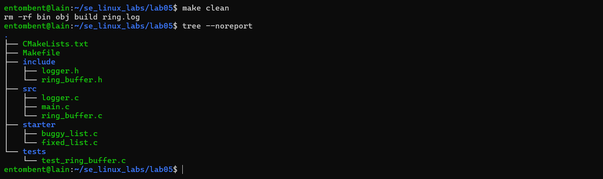

Крок 2. Вихідний код:
Файл include/ring_buffer.h:
```c
#ifndef RING_BUFFER_H
#define RING_BUFFER_H

#include <stddef.h>
#include <stdint.h>
#include <time.h>

#define RING_MSG_LEN 48

typedef struct {
    uint32_t seq;
    time_t timestamp;
    char msg[RING_MSG_LEN];
} LogEntry;

typedef struct {
    LogEntry *head;
    LogEntry *tail;
    LogEntry *buf;
    LogEntry *end;
    size_t capacity;
    size_t count;
    uint32_t next_seq;
} RingBuffer;

RingBuffer *ring_create(size_t capacity);
void ring_push(RingBuffer *ring, const char *msg);
int ring_pop(RingBuffer *ring, LogEntry *out);
size_t ring_size(const RingBuffer *ring);
void ring_destroy(RingBuffer *ring);

#endif
```

Файл include/logger.h:
```c
#ifndef LOGGER_H
#define LOGGER_H

#include "ring_buffer.h"

typedef struct Logger Logger;

Logger *logger_open(const char *path);
int logger_write(Logger *logger, const LogEntry *entry);
void logger_close(Logger *logger);

#endif
```

Файл src/ring_buffer.c:
```c
#include "ring_buffer.h"

#include <stdio.h>
#include <stdlib.h>

RingBuffer *ring_create(size_t capacity)
{
    if (capacity == 0)
        return NULL;

    LogEntry *buf = calloc(capacity, sizeof(LogEntry));
    if (!buf)
        return NULL;

    RingBuffer *ring = malloc(sizeof(RingBuffer));
    if (!ring) {
        free(buf);
        return NULL;
    }

    ring->buf = buf;
    ring->head = buf;
    ring->tail = buf;
    ring->end = buf + capacity;
    ring->capacity = capacity;
    ring->count = 0;
    ring->next_seq = 1;
    return ring;
}

static LogEntry *ring_next(const RingBuffer *ring, LogEntry *slot)
{
    slot++;
#ifdef RING_BUG
    if (slot > ring->end)
        slot = ring->buf;
#else
    if (slot >= ring->end)
        slot = ring->buf;
#endif
    return slot;
}

void ring_push(RingBuffer *ring, const char *msg)
{
    LogEntry *slot = ring->head;

    slot->seq = ring->next_seq++;
    slot->timestamp = time(NULL);
    snprintf(slot->msg, sizeof(slot->msg), "%s", msg);

    ring->head = ring_next(ring, ring->head);

    if (ring->count == ring->capacity)
        ring->tail = ring_next(ring, ring->tail);
    else
        ring->count++;
}

int ring_pop(RingBuffer *ring, LogEntry *out)
{
    if (ring->count == 0)
        return 0;

    *out = *ring->tail;
    ring->tail = ring_next(ring, ring->tail);
    ring->count--;
    return 1;
}

size_t ring_size(const RingBuffer *ring)
{
    return ring->count;
}

void ring_destroy(RingBuffer *ring)
{
    if (!ring)
        return;
    free(ring->buf);
    free(ring);
}
```

Файл src/logger.c:
```c
#define _POSIX_C_SOURCE 200809L

#include "logger.h"

#include <stdio.h>
#include <stdlib.h>
#include <time.h>

struct Logger {
    FILE *fp;
};

Logger *logger_open(const char *path)
{
    Logger *logger = malloc(sizeof(Logger));
    if (!logger)
        return NULL;

    logger->fp = fopen(path, "w");
    if (!logger->fp) {
        free(logger);
        return NULL;
    }
    return logger;
}

int logger_write(Logger *logger, const LogEntry *entry)
{
    struct tm tm_buf;
    char stamp[32];

    if (!localtime_r(&entry->timestamp, &tm_buf))
        return -1;
    strftime(stamp, sizeof(stamp), "%Y-%m-%d %H:%M:%S", &tm_buf);

    if (fprintf(logger->fp, "%s [#%04u] %s\n", stamp, entry->seq, entry->msg) < 0)
        return -1;
    return fflush(logger->fp);
}

void logger_close(Logger *logger)
{
    if (!logger)
        return;
    fclose(logger->fp);
    free(logger);
}
```

Файл src/main.c:
```c
#include "logger.h"
#include "ring_buffer.h"

#include <errno.h>
#include <stdio.h>
#include <stdlib.h>

#define LOG_PATH "ring.log"

static int parse_positive(const char *text, unsigned long *value)
{
    char *end;

    errno = 0;
    *value = strtoul(text, &end, 10);
    return errno == 0 && end != text && *end == '\0' && *value > 0;
}

static unsigned long drain(RingBuffer *ring, Logger *logger)
{
    LogEntry entry;
    unsigned long written = 0;

    while (ring_pop(ring, &entry)) {
        if (logger_write(logger, &entry) != 0) {
            perror("logger_write");
            break;
        }
        written++;
    }
    return written;
}

int main(int argc, char *argv[])
{
    unsigned long capacity = 4;
    unsigned long events = 10;

    if (argc > 3 || (argc > 1 && !parse_positive(argv[1], &capacity)) ||
        (argc > 2 && !parse_positive(argv[2], &events))) {
        fprintf(stderr, "Usage: %s [capacity] [events]\n", argv[0]);
        return EXIT_FAILURE;
    }

    RingBuffer *ring = ring_create(capacity);
    if (!ring) {
        perror("ring_create");
        return EXIT_FAILURE;
    }

    Logger *logger = logger_open(LOG_PATH);
    if (!logger) {
        perror(LOG_PATH);
        ring_destroy(ring);
        return EXIT_FAILURE;
    }

    unsigned long drain_every = capacity + 2;
    unsigned long logged = 0;

    for (unsigned long i = 1; i <= events; i++) {
        char text[128];

        snprintf(text, sizeof(text),
                 "event #%04lu: sensor reading temperature=23.5C", i);
        ring_push(ring, text);

        if (i % drain_every == 0)
            logged += drain(ring, logger);
    }
    logged += drain(ring, logger);

    printf("events pushed: %lu, entries logged: %lu, capacity: %lu, log: %s\n",
           events, logged, capacity, LOG_PATH);

    logger_close(logger);
    ring_destroy(ring);
    return EXIT_SUCCESS;
}
```

Крок 3. Збірка через Makefile:
Файл Makefile:
```makefile
CC       = gcc
CPPFLAGS = -Iinclude -MMD -MP
CFLAGS   = -std=c11 -Wall -Wextra -Werror -g3
LDFLAGS  =

MODE ?= debug
BUG  ?= 0

ifeq ($(MODE),debug)
  CFLAGS += -O0
else ifeq ($(MODE),asan)
  CFLAGS  += -O1 -fsanitize=address -fno-omit-frame-pointer
  LDFLAGS += -fsanitize=address
else ifeq ($(MODE),release)
  CFLAGS += -O3
else
  $(error Unknown MODE '$(MODE)', expected debug, asan or release)
endif

ifeq ($(BUG),1)
  CPPFLAGS += -DRING_BUG
  VARIANT   = $(MODE)_bug
else
  VARIANT   = $(MODE)
endif

OBJ_DIR = obj/$(VARIANT)
BIN_DIR = bin

LIB_OBJS  = $(OBJ_DIR)/ring_buffer.o $(OBJ_DIR)/logger.o
APP_OBJS  = $(OBJ_DIR)/main.o $(LIB_OBJS)
TEST_OBJS = $(OBJ_DIR)/test_ring_buffer.o $(LIB_OBJS)

TARGET   = $(BIN_DIR)/ring_logger_$(VARIANT)
TEST_BIN = $(BIN_DIR)/test_ring_buffer_$(VARIANT)

vpath %.c src tests

.PHONY: all debug asan release test clean

all: $(TARGET)

debug asan release:
	@$(MAKE) --no-print-directory MODE=$@ all

test: $(TEST_BIN)
	./$(TEST_BIN)

$(TARGET): $(APP_OBJS) | $(BIN_DIR)
	$(CC) $(CFLAGS) $(LDFLAGS) $^ -o $@

$(TEST_BIN): $(TEST_OBJS) | $(BIN_DIR)
	$(CC) $(CFLAGS) $(LDFLAGS) $^ -o $@

$(OBJ_DIR)/%.o: %.c | $(OBJ_DIR)
	$(CC) $(CPPFLAGS) $(CFLAGS) -c $< -o $@

$(BIN_DIR) $(OBJ_DIR):
	mkdir -p $@

clean:
	rm -rf bin obj build ring.log

-include $(APP_OBJS:.o=.d) $(TEST_OBJS:.o=.d)
```
Збірка виконується за допомогою цілей `make debug`, `make asan`, `make release`, підтримуючи автоматичну генерацію залежностей (`-MMD -MP`) та умовне підключення дефекту через `BUG=1`.
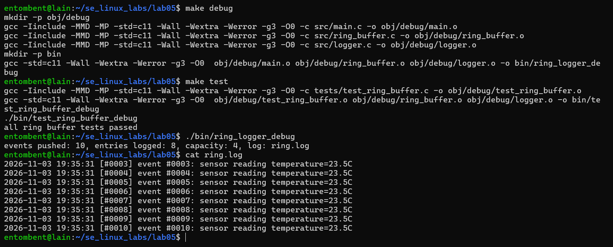

Крок 4. Аналіз стартового каркаса з помилкою:
Аналіз демонстраційного каркаса з навмисними помилками показав роботу утиліт діагностики з виявлення витоків пам'яті та звернень після звільнення.
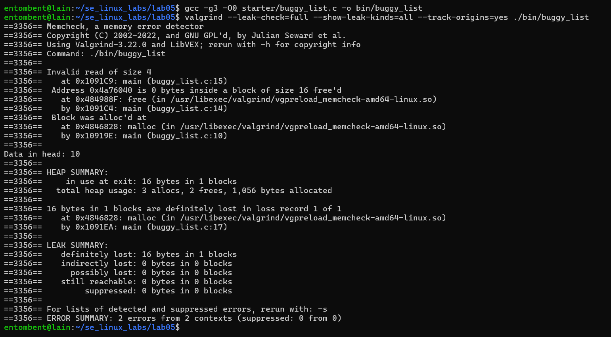
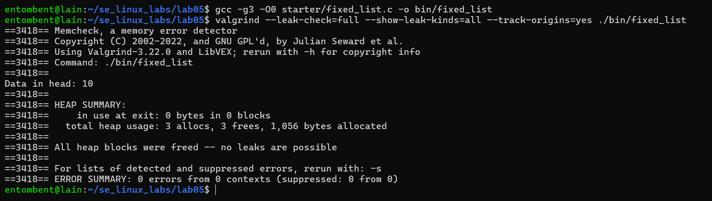

Крок 5. Збірка за допомогою CMake:
Файл CMakeLists.txt:
```cmake
cmake_minimum_required(VERSION 3.20)
project(ring-logger
        VERSION 1.0.0
        DESCRIPTION "Ring buffer event logger"
        LANGUAGES C)

set(CMAKE_C_STANDARD 11)
set(CMAKE_C_STANDARD_REQUIRED ON)
set(CMAKE_C_EXTENSIONS OFF)

if(NOT CMAKE_BUILD_TYPE)
    set(CMAKE_BUILD_TYPE Release)
endif()

option(ENABLE_ASAN "Build with AddressSanitizer" OFF)
option(ENABLE_RING_BUG "Compile in the ring buffer defect" OFF)

add_library(ringbuf STATIC src/ring_buffer.c src/logger.c)
target_include_directories(ringbuf PUBLIC include)
target_compile_options(ringbuf PUBLIC -Wall -Wextra -Werror -g3)

if(ENABLE_RING_BUG)
    target_compile_definitions(ringbuf PRIVATE RING_BUG)
endif()

if(ENABLE_ASAN)
    target_compile_options(ringbuf PUBLIC -fsanitize=address -fno-omit-frame-pointer)
    target_link_options(ringbuf PUBLIC -fsanitize=address)
endif()

add_executable(ring_logger src/main.c)
target_link_libraries(ring_logger PRIVATE ringbuf)

enable_testing()
add_executable(test_ring_buffer tests/test_ring_buffer.c)
target_link_libraries(test_ring_buffer PRIVATE ringbuf)
add_test(NAME ring_buffer COMMAND test_ring_buffer)

include(GNUInstallDirs)
install(TARGETS ring_logger RUNTIME DESTINATION ${CMAKE_INSTALL_BINDIR})

set(CPACK_GENERATOR "DEB")
set(CPACK_PACKAGE_NAME "ring-logger")
set(CPACK_PACKAGE_VERSION "${PROJECT_VERSION}")
set(CPACK_PACKAGE_DESCRIPTION_SUMMARY "${PROJECT_DESCRIPTION}")
set(CPACK_DEBIAN_PACKAGE_MAINTAINER "Dmytro Lahoda (IPZ-23-5)")
set(CPACK_DEBIAN_PACKAGE_SECTION "utils")
set(CPACK_DEBIAN_FILE_NAME DEB-DEFAULT)
set(CPACK_DEBIAN_PACKAGE_SHLIBDEPS ON)
include(CPack)
```
Конфігурація виконує out-of-source збірку у каталозі `build/`.
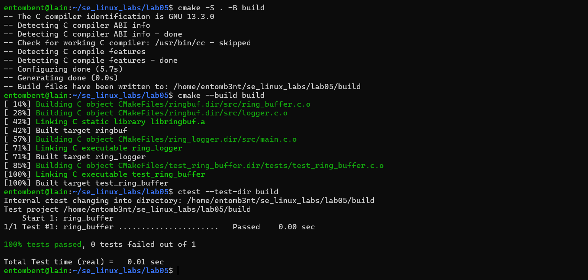

Крок 6. Генерація пакету через CPack:
За допомогою CPack створено інсталяційний пакет формату `.deb`.
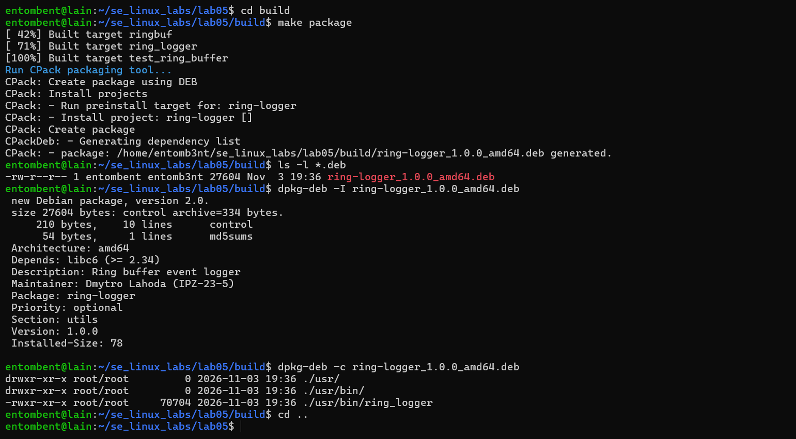
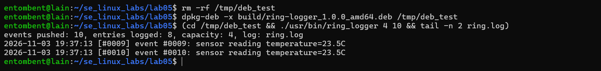

Крок 7. Налагодження в GDB:
Проведено сесію покрокового налагодження у GDB з моніторингом вказівників та встановленням точок зупинки й watchpoint.
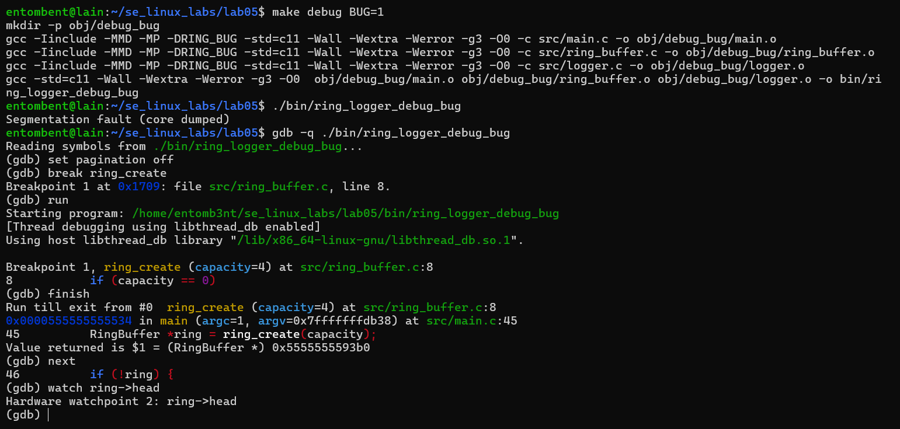
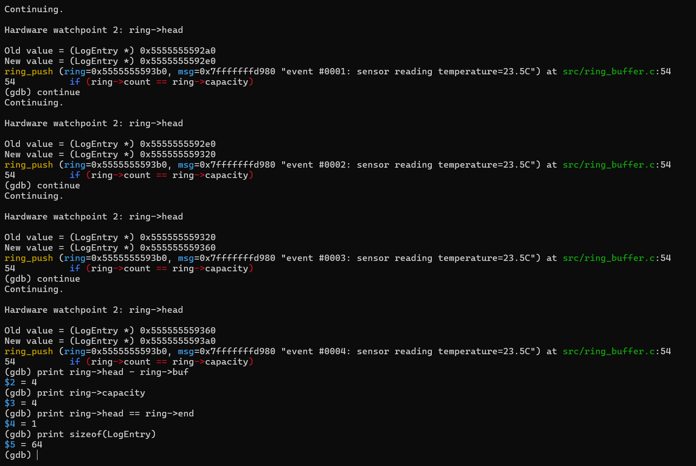
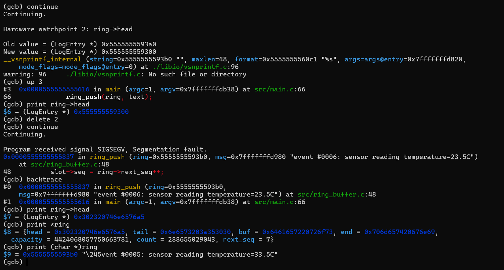

Крок 8. Динамічний аналіз пам'яті (Valgrind та ASan):
Виявлено помилки порушення пам'яті (Memory Corruption) при перезаписі буфера у варіанті з дефектом (`RING_BUG`), а також перевірено виправлений код.
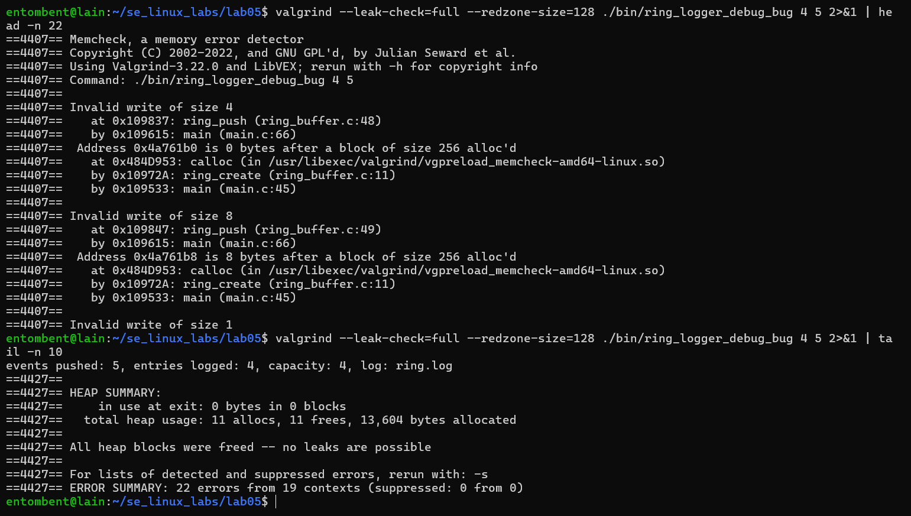
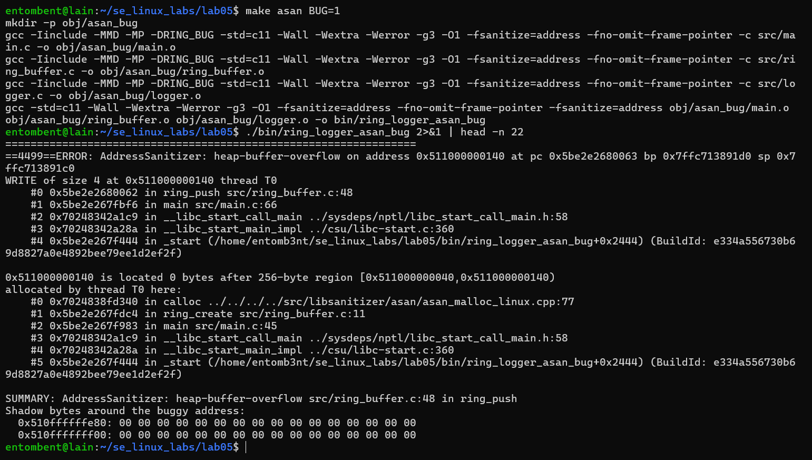
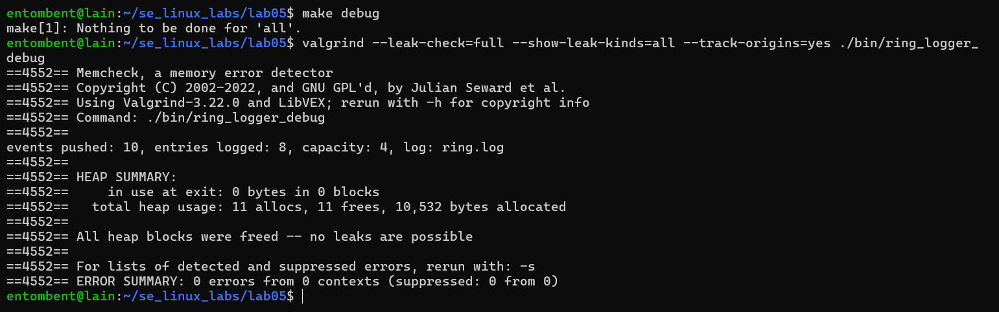
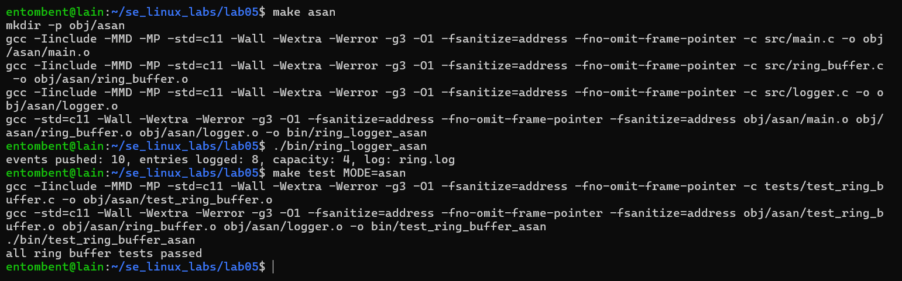

Крок 9. Трасування системних викликів (strace):
Проведено профільну оцінку системних викликів програми за допомогою `strace`.
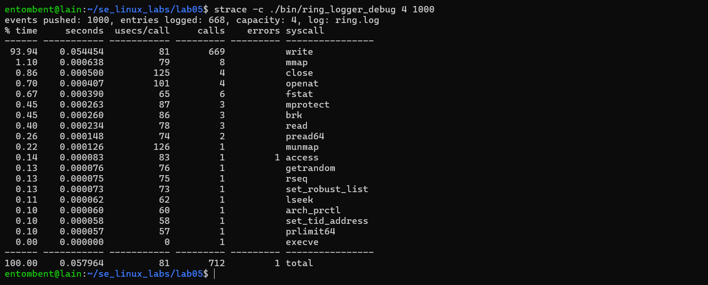
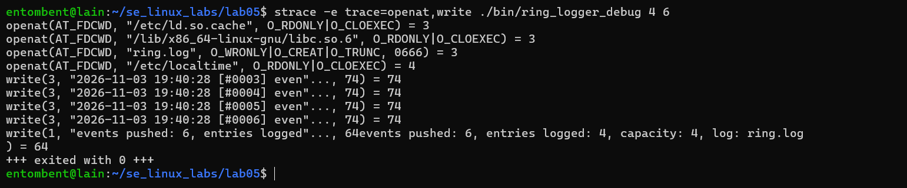

## 5. Відповіді на контрольні запитання
1. Чому для налагодження в GDB програму необхідно збирати з прапорцями `-g3` та `-O0`?
Прапорець `-g3` забезпечує максимальний рівень генерації відлагоджувальних символів у форматі DWARF (включно з макросами та статичними змінними), а `-O0` вимикає будь-які оптимізації компілятора, які можуть переносити рядки коду або оптимізувати локальні змінні, роблячи покрокове виконання у GDB наочним і передбачуваним.

2. Яку роль відіграють цілі `.PHONY` у файлах Makefile?
Ціль `.PHONY` вказує Make, що вказані цілі (наприклад, `all`, `clean`, `test`) є віртуальними і не відповідають реальним файлам на диску. Це запобігає конфліктам, якщо в каталозі з'явиться файл із назвою цілі, і примусово виконує команди цілі щоразу.

3. Чим відрізняється робота мета-генератора CMake від класичної утиліти Make?
CMake не виконує компіляцію напряму, а є генератором конфігурацій (мета-збірником), який перетворює кросплатформні файли `CMakeLists.txt` у нативні файли збірки для конкретної системи (наприклад, Makefile для GNU Make або файли проєктів для Ninja / Visual Studio).

4. Які типи помилок пам'яті виявляє Valgrind Memcheck і як інтерпретувати статус "Definitely lost"?
Valgrind Memcheck виявляє витоки пам'яті, використання неініціалізованої пам'яті, звернення за межі буферів та подвійне звільнення (`Double Free`). Статус "Definitely lost" означає, що на момент завершення програми в динамічній пам'яті залишилися виділені блоки, на які немає жодних дійсних вказівників, тобто це чистий витік пам'яті (Memory Leak).

5. Що таке AddressSanitizer і які переваги він має перед Valgrind за швидкістю виконання?
AddressSanitizer (ASan) — це інструмент швидкого виявлення помилок пам'яті на рівні компілятора (шляхом ін'єкції перевірок під час трансляції коду). Його перевага полягає у значно меншому сповільненні виконання програми (у 2–3 рази порівняно з 10–20 разів у Valgrind), хоча він вимагає перекомпіляції всього коду.

6. Для чого призначена утиліта strace і як отримати статистику системних викликів за допомогою ключа `-c`?
Утиліта `strace` призначена для перехоплення та трасування системних викликів, які виконує процес, а також сигналів, що він отримує. Ключ `-c` змушує `strace` підсумовувати час виконання, кількість викликів і помилки для кожного системного виклику у вигляді зведеної таблиці при завершенні програми.

## 6. Висновки
Опановано інструменти автоматизації збірки Make та CMake, а також методи низькорівневого налагодження й аналізу пам'яті.
1. Створено мультимодульний C-проєкт циклічного буфера логування з ручною збіркою через Makefile та генерацією через CMake, досягнуто нульової кількості помилок компіляції з прапорцями `-Wall -Wextra -Werror -g3`.
2. Локалізовано та виправлено дефект пам'яті (`Memory Corruption`) у циклічному буфері за допомогою GDB, Valgrind Memcheck та AddressSanitizer (звіт Valgrind показав 0 помилок після виправлення).
3. Згенеровано інсталяційний `.deb` пакет за допомогою CPack та проведено аудит системних викликів програми через `strace`.

## 7. Список використаних джерел
1. Peter Jay Salzman, Michael Burian. *The Art of Debugging with GDB, DDD, and Eclipse*. No Starch Press.
2. Robert Love. *Linux System Programming*.
3. Valgrind User Manual: [https://valgrind.org/docs/manual/manual.html](https://valgrind.org/docs/manual/manual.html)
4. Linux Manual Pages: System Documentation & Reference Guides [Електронний ресурс] / The Linux man-pages project. - Режим доступу: [https://man7.org/linux/man-pages/](https://man7.org/linux/man-pages/)
