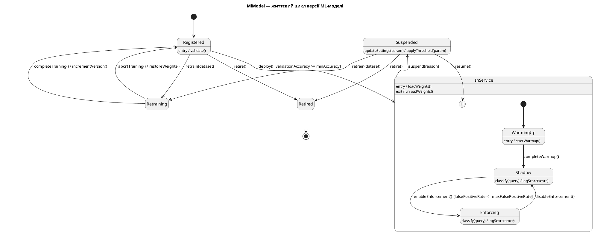

# Лабораторна робота №05. Моделювання станів (State Machine)

**Студент:** Лагода Дмитро, ІПЗ-23-5 · **Предметна область:** Система управління ML-моделями

## 1. Мета
Розробити діаграму станів (State Machine Diagram) для ключового класу предметної області `MlModel`, що описує його життєвий цикл та переходи між станами.

## 2. Вихідні дані
| Що використано | Звідки |
| :--- | :--- |
| Класи предметної області | `lab02/lab02_classes.puml` |
| Глосарій | `glossary.md` |

## 3. Виконання
### 3.1. Діаграма станів MlModel
Файл: [lab05_mlmodel_state.puml](lab05_mlmodel_state.puml)

**Пояснення рішень:**
Діаграма відображає життєвий цикл моделі від реєстрації до виведення з експлуатації.
- `Registered`: початковий стан, де виконується валідація.
- `InService`: складний стан, що містить підстани `WarmingUp`, `Shadow` та `Enforcing`, які описують процес розгортання та моніторингу моделі.
- `Suspended`: стан призупинення, з якого можна повернутися до роботи (`resume`) або перейти до перенавчання.
- `Retraining`: стан перенавчання, що завершується створенням нової версії моделі.

## 4. Узгодженість з попередніми лабами
| Елемент | Де вже є | Що змінилося |
| :--- | :--- | :--- |
| `MlModel` | `lab02_classes.puml` | Додано логіку станів для життєвого циклу |

## 5. Використання ШІ
TODO: описати використання ШІ

## 6. Висновки
У ході роботи було змодельовано життєвий цикл `MlModel`. Визначено основні стани та переходи, що дозволяє контролювати процес розгортання та оновлення моделей у системі.
