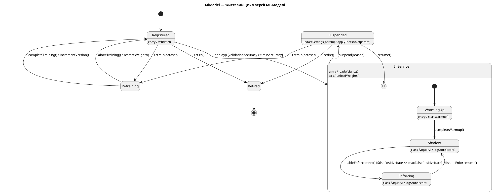

# Лабораторна робота №5. Побудова діаграми станів об'єкта

**Студент:** Лагода Дмитро, ІПЗ-23-5 · **Предметна область:** Сервіс машинного навчання (ML-моделі)

## 1. Мета
Закріпити на практиці матеріал лекції 8 і навчитися будувати діаграму станів (**State Machine Diagram**) мови **UML** для класу `MlModel` курсового завдання: виражати життєвий цикл об'єкта через стани, застосовувати псевдостан історії, дії входу й виходу, внутрішні переходи та переходи з охоронними умовами.

## 2. Вихідні дані
| Що використано | Звідки |
|---|---|
| Клас `MlModel` | Лаб. №2 (Діаграма класів) |
| Методи класу | Лаб. №2 (Діаграма класів) |
| Специфікація життєвого циклу | Власна розробка (на основі бізнес-логіки ML-сервісу) |

## 3. Виконання

### 3.1. Діаграма станів об'єкта MlModel
Файл: [lab05_mlmodel_state.puml](lab05_mlmodel_state.puml)

**Пояснення рішень:**
- **Складений стан `InService`**: містить підстани `WarmingUp`, `Shadow`, `Enforcing`. Це дозволяє інкапсулювати логіку роботи моделі, коли вона вже розгорнута.
- **Псевдостан історії `[H]`**: використано для повернення моделі до попереднього підстану (`Shadow` або `Enforcing`) після виходу зі стану `Suspended`.
- **Охоронні умови**: `[validationAccuracy >= minAccuracy]` при переході до `InService` гарантує, що модель не буде розгорнута, якщо вона не пройшла валідацію. `[falsePositiveRate <= maxFalsePositiveRate]` при переході до `Enforcing` гарантує безпеку використання моделі.
- **Дії входу/виходу**: `entry / validate()` у `Registered`, `entry / startWarmup()` у `WarmingUp`, `entry / loadWeights()` та `exit / unloadWeights()` у `InService`.
- **Внутрішній перехід**: `classify(query) / logScore(score)` у станах `Shadow` та `Enforcing` дозволяє обробляти запити без зміни стану.
- **Навмисно відсутні переходи**: з підстанів `WarmingUp` та `Shadow` немає прямого переходу до `Retired` або `Retraining`. Це бізнес-правило: модель повинна бути спочатку призупинена (`suspend`) або завершити поточний цикл роботи, щоб уникнути некоректного завершення або перенавчання під час активного виведення.

## 4. Узгодженість з попередніми лабами
| Елемент | Де вже є | Що змінилося |
|---|---|---|
| Клас `MlModel` | Лаб. №2 | Додано стани та переходи, що відповідають методам класу |
| Методи `deploy`, `retrain`, `suspend` | Лаб. №2 | Використані як події на діаграмі станів |

## 5. Використання ШІ
TODO: описати використання ШІ

## 6. Висновки
Побудовано діаграму станів для класу `MlModel`. Визначено життєвий цикл моделі, що включає реєстрацію, розгортання, призупинення, перенавчання та виведення з експлуатації. Застосування складених станів та псевдостану історії дозволило коректно змоделювати складну поведінку моделі під час її експлуатації.
