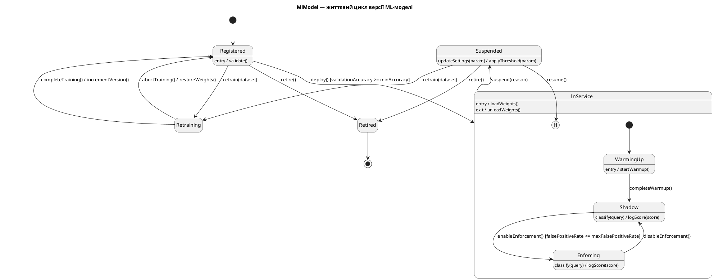

# Лабораторна робота №5. Побудова діаграми станів об'єкта

**Студент:** Лагода Дмитро, ІПЗ-23-5 · **Предметна область:** Система керування ML-моделями

## 1. Мета
Закріпити на практиці матеріал лекції 8 і навчитися будувати діаграму станів (**State Machine Diagram**) мови **UML** для класу `MlModel` курсового завдання: виражати життєвий цикл об'єкта через прості й складені стани, застосовувати псевдостан історії, дії входу й виходу, внутрішні переходи та переходи з охоронними умовами.

## 2. Вихідні дані
| Що використано | Звідки |
|---|---|
| Клас `MlModel` | Лабораторна робота №2 |
| Специфікація життєвого циклу моделі | Лабораторна робота №1 |

## 3. Виконання
### 3.1. Діаграма станів `MlModel`
Файл: [lab05_mlmodel_state.puml](lab05_mlmodel_state.puml)

**Пояснення рішень:**
- **Складений стан `InService`**: Об'єкт `MlModel` під час роботи проходить через етапи розігріву (`WarmingUp`), тіньового режиму (`Shadow`) та активного використання (`Enforcing`).
- **Псевдостан історії `[H]`**: Використано для повернення моделі до попереднього підстану (наприклад, `Shadow` або `Enforcing`) після відновлення роботи з режиму `Suspended`.
- **Охоронні умови**: Перехід до `InService` можливий лише за умови `[validationAccuracy >= minAccuracy]`, що гарантує якість моделі перед розгортанням.
- **Дії входу/виходу**: `Registered` виконує `validate()` при вході, а `InService` завантажує та вивантажує ваги моделі.
- **Внутрішній перехід**: У стані `Suspended` реалізовано `updateSettings(param)`, що дозволяє змінювати параметри без виходу зі стану.
- **Навмисно відсутні переходи**: Зі стану `Retraining` неможливо перейти безпосередньо в `InService`. Модель обов'язково має пройти через стан `Registered` для повторної валідації, що є критичним бізнес-правилом для запобігання виходу в продуктивне середовище неперевірених моделей.

## 4. Узгодженість з попередніми лабами
| Елемент | Де вже є | Що змінилося |
|---|---|---|
| Клас `MlModel` | Лаб. №2 | Додано атрибути та методи, що відповідають подіям діаграми станів |

## 5. Використання ШІ
TODO: описати використання ШІ

## 6. Висновки
У ході роботи було побудовано діаграму станів для класу `MlModel`. Моделювання дозволило виявити необхідність проміжного стану `Registered` для валідації після перенавчання, а також чітко визначити умови переходу моделі в продуктивне середовище. Використання складеного стану `InService` дозволило структурувати логіку роботи моделі, відокремивши етапи розігріву та використання.
