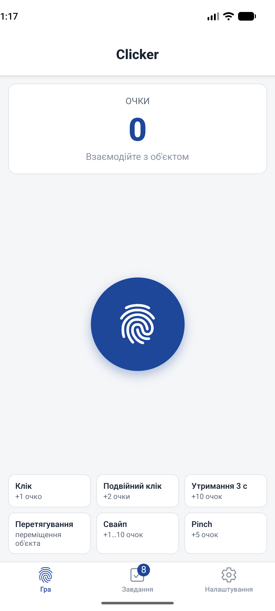
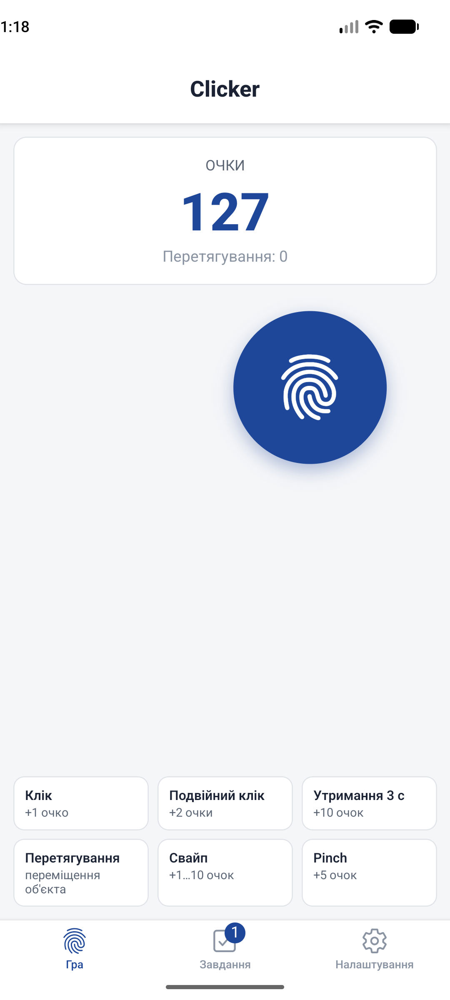
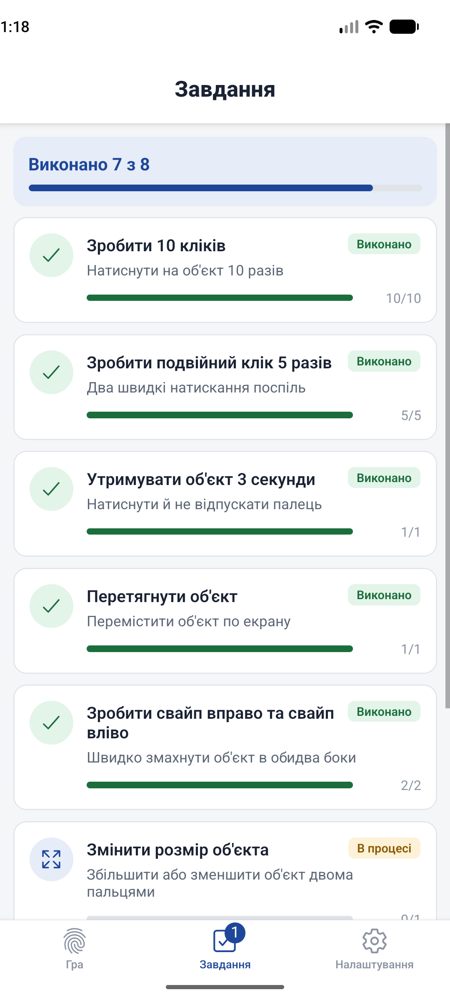
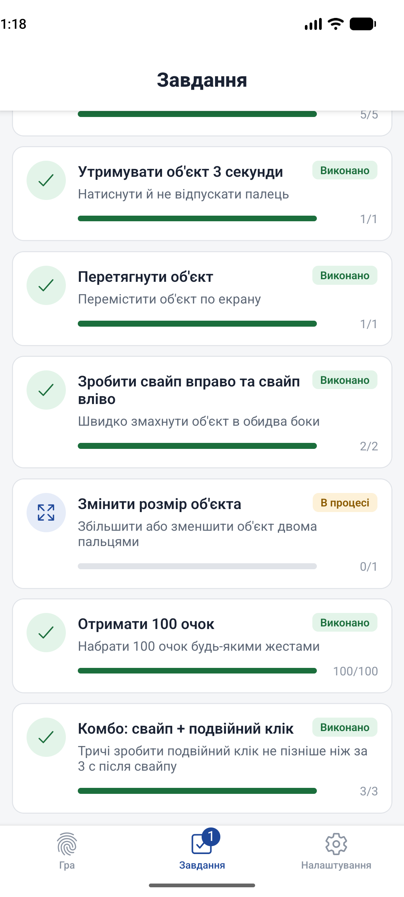
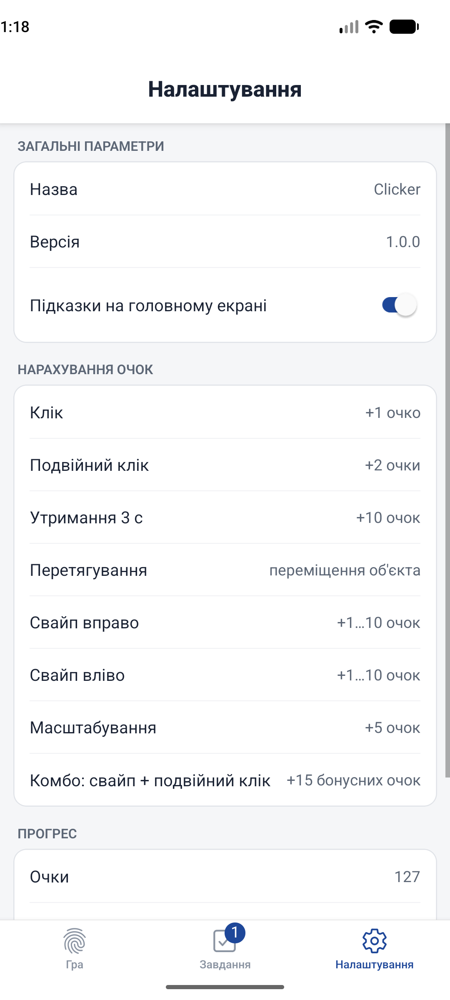
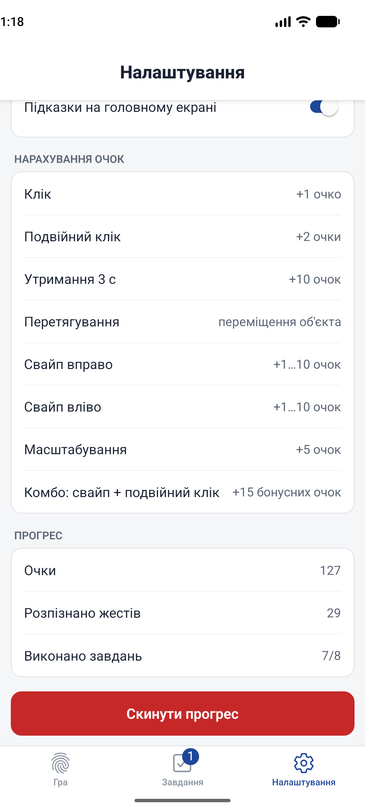
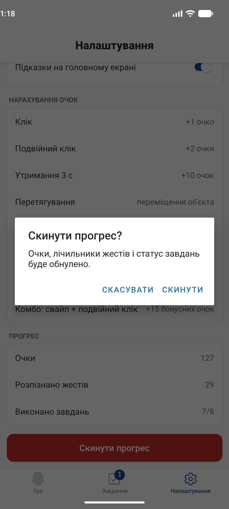

# Лабораторна робота №4 — Опрацювання жестів користувача та реалізація інтерактивної взаємодії у React Native

## Опис проєкту

Мобільний застосунок «Clicker» — це інтерактивний клікер, побудований на базі жестів бібліотеки `react-native-gesture-handler` з плавною анімацією відгуку через `react-native-reanimated`. Додаток складається з трьох екранів у нижній панелі вкладок: головного екрана гри, списку завдань та екрана налаштувань.

На головному екрані розташовано лічильник очок, підказку про останній жест та круглий інтерактивний об'єкт розміром 140 pt, який реагує на поодиноке натискання (+1 очко), подвійне натискання (+2 очки), утримання протягом 3000 мс (+10 очок), вільне перетягування в межах поля з порогом 30 pt (0 очок), швидкі свайпи вправо й вліво з нарахуванням випадкових від 1 до 10 очок, а також масштабування двома пальцями в діапазоні від 0.6 до 2.2 із порогом зміни масштабу 0.15 (+5 очок). Реалізовано власне комбіноване правило: подвійний клік протягом 3000 мс після свайпу приносить додаткові 15 бонусних очок.

Екран завдань відстежує 8 цілей (10 кліків, 5 подвійних кліків, 3 с утримання, перетягування, свайпи в обидва боки, масштабування, 100 очок та комбо зі свайпу й подвійного кліку) із відображенням смуг прогресу, числових індикаторів та бейджів стану. Всі дані гри (очки, лічильники кожного типу жестів та стан виконання завдань) зберігаються в пам'яті за допомогою React Context (`useReducer`) і скидаються при перезапуску програми або через діалогове вікно підтвердження на екрані налаштувань, де також можна переглянути версію та вимкнути картки-підказки головного екрана.

Стек: Expo SDK ~58.0.23, react-native 0.88.1, react-native-gesture-handler ~3.3.0, react-native-reanimated 4.7.1, expo-router ~58.0.30, react-native-worklets 0.13.0, @expo/vector-icons ^15.0.2.

## Структура маршрутів

```text
src/app/
├── _layout.jsx   # Кореневий шар: GestureHandlerRootView, GameProvider та нижня панель Tabs із трьома вкладками
├── index.jsx     # Головний екран: лічильник очок, об'єкт взаємодії ClickerObject та картки підказок жестів
├── settings.jsx  # Екран налаштувань: версія, перемикач підказок, правила очок, статистика та кнопка скидання
└── tasks.jsx     # Екран завдань: FlatList зі списком 8 завдань та підсумковим індикатором прогресу
```

## Інструкція із запуску

```bash
npm install
npx expo start
```

| Дія | Результат |
| --- | --- |
| Сканування QR-коду через Expo Go (Android / iOS) | Запуск мобільного застосунку на реальному пристрої |
| Натискання клавіші `a` у терміналі | Запуск застосунку в емуляторі Android |
| `npx expo start --clear` | Запуск сервера розробки з попереднім очищенням кешу Bundler |
| `npx expo start --tunnel` | Запуск через тунельоване з'єднання при різних підмережах ПК і смартфона |

## Скріншоти









## Висновки

Реалізовано повноцінний мобільний клікер з опрацюванням одиночних, подвійних, довгих, панорамних, свайпових та масштабувальних жестів з використанням сучасного API бібліотеки `react-native-gesture-handler` і `GestureDetector`. Взаємодію налаштовано із пріоритезацією та композицією (`useExclusiveGestures`, `useSimultaneousGestures`), а передачу подій у глобальний стан організовано через `scheduleOnRN` із `react-native-worklets`. Роботу інтерфейсу, навігацію `expo-router` та анімації `react-native-reanimated` перевірено на платформі iOS.

**1. Які основні типи жестів надає бібліотека react-native-gesture-handler та для яких сценаріїв взаємодії вони призначені?**

Бібліотека надає набір жестів для дискретних і безперервних сценаріїв взаємодії: тапи (`Gesture.Tap` або `useTapGesture`) призначені для звичайних кліків і багаторазових натискань; утримання (`Gesture.LongPress` або `useLongPressGesture`) — для виклику контекстних дій або накопичення заряду тривалим натисканням; перетягування (`Gesture.Pan` або `usePanGesture`) — для вільного переміщення об'єктів та відстеження траєкторії пальця; швидкий зсув (`Gesture.Fling` або `useFlingGesture`) — для миттєвих змахувань у фіксованому напрямку; масштабування (`Gesture.Pinch` або `usePinchGesture`) та обертання (`Gesture.Rotation` або `useRotationGesture`) — для трансформацій об'єктів двома пальцями; силовий дотик (`Gesture.ForceTouch`) — для пристроїв із підтримкою сили тиску на екран. У розробленому проєкті цей набір покриває одиночний і подвійний клік, трисекундне утримання, рух у межах ігрової зони, свайпи вліво/вправо та зміну масштабу іконки.

**2. У чому відмінність між обробкою переміщення об'єкта за допомогою PanGestureHandler та швидкого зсуву через FlingGestureHandler?**

Ключова відмінність полягає в характері жесту та життєвому циклі його подій: `PanGesture` є безперервним (continuous) жестом, що генерує потік оновлень координат під час усього руху пальця (`onUpdate`), дозволяючи синхронно змінювати зміщення об'єкта `translateX`/`translateY` за пальцем користувача з урахуванням швидкості й відстані. Натомість `FlingGesture` є дискретним (discrete) жестом, який спрацьовує одноразово (`onActivate`) лише за умови, що швидкість та вектор зсуву пальця у визначеному напрямку перевищили мінімальний системний поріг за короткий проміжок часу. У проєкті `pan` забезпечує плавне тягання кнопки в межах контейнера, а `fling` розпізнає енергійний горизонтальний свайп для нарахування випадкових очок і запуску анімації розгойдування.

**3. Навіщо у корені застосунку необхідно обгортати компоненти в GestureHandlerRootView?**

Компонент `GestureHandlerRootView` потрібен для ініціалізації та функціонування нативної підсистеми обробки жестів на боці Android та iOS. Він монтує нативний кореневий контейнер, перехоплює всі події дотику (touch events) операційної системи ще до стандартного диспетчера React Native і передає їх у диспетчер жестів бібліотеки, що усуває конфлікти із системними жестами та забезпечує роботу взаємодій безпосередньо у нативному потоці (UI thread). У проєкті `GestureHandlerRootView` розміщено у файлі `src/app/_layout.jsx`, що дозволяє коректно взаємодіяти з вкладками `expo-router` та вкладеним `ClickerObject`.

**4. Яким чином можна реалізувати одночасне або послідовне спрацьовування кількох жестів на одному елементі?**

Для координації жестів сучасний API бібліотеки надає методи композиції `Gesture.Simultaneous` (хук `useSimultaneousGestures`), `Gesture.Exclusive` (хук `useExclusiveGestures`) та `Gesture.Race` (хук `useRaceGestures`). Одночасне спрацьовування реалізується через `Simultaneous`, дозволяючи кільком жестам визнаватися паралельно без взаємного блокування — у проєкті це застосовано для спільної роботи `pan`, `pinch`, `fling` та `longPress`. Послідовне або взаємовиключне спрацьовування (наприклад, одиночного і подвійного тапу) реалізується через `Exclusive`: подвійний тап має вищий пріоритет, а одиночний активується лише після того, як подвійний зазнає невдачі (`useExclusiveGestures(doubleTap, tap)`). Послідовність у часі («комбо») реалізується через збереження часової мітки першої події (`lastFlingAt.current`) та перевірку вікна спрацьовування під час виклику наступного жесту.
